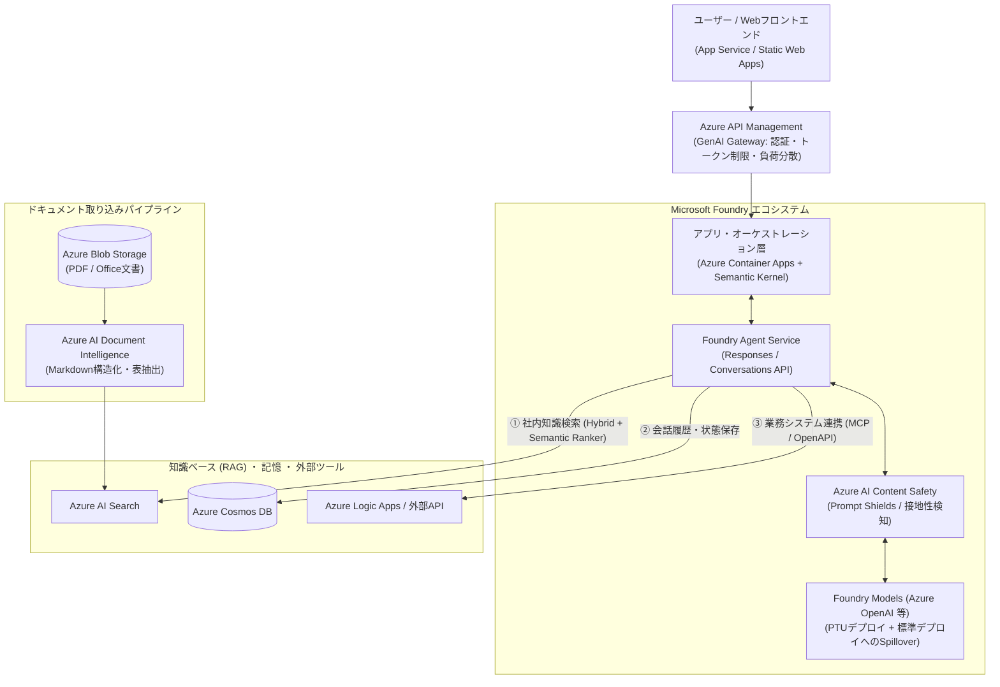

# AIエージェント・生成AI・機械学習開発

生成AIおよびAIエージェント開発における Microsoft Azure のサービス群を、Microsoft Learn の現行公式情報に基づき、AWSの **Amazon Bedrock** エコシステムと対比しながら解説します。

> [!IMPORTANT]
> **Microsoft AI プラットフォームの名称変更について**
> Microsoft の生成AI関連サービスは、現行の公式ドキュメントにおいて以下の名称に更新されています。旧名称の資料やブログを参照する際は読み替えが必要です。
> * 旧 Azure AI Foundry / Azure AI Studio $\rightarrow$ **[Microsoft Foundry](https://learn.microsoft.com/azure/ai-foundry/what-is-azure-ai-foundry)**
> * 旧 Azure AI Agent Service $\rightarrow$ **[Foundry Agent Service](https://learn.microsoft.com/azure/ai-foundry/agents/overview)**
> * 旧 Azure AI Services / Azure Cognitive Services $\rightarrow$ **[Foundry Tools](https://learn.microsoft.com/azure/ai-services/what-are-ai-services)**

---

## 1. 生成AI・AIエージェント関連サービスの全体像とAWS比較

| レイヤー / 役割 | AWS サービス | Azure サービス（現行名称） | 特徴・提供条件とAWS経験者向け解説 |
| :--- | :--- | :--- | :--- |
| **生成AI統合開発プラットフォーム** | Amazon Bedrock | **[Microsoft Foundry](https://learn.microsoft.com/azure/ai-foundry/what-is-azure-ai-foundry)** (旧 Azure AI Foundry / AI Studio) | モデルカタログ、プレイグラウンド、プロンプト管理、評価（Evaluation）、トレース、安全性フィルタ、エージェント開発を統合したポータルおよびSDK基盤。 |
| **LLMモデル提供基盤** | Amazon Bedrock (Claude / Nova / Llama等) | **[Foundry Models](https://learn.microsoft.com/azure/ai-foundry/concepts/foundry-models-overview)** (**[Azure OpenAI](https://learn.microsoft.com/azure/ai-foundry/openai/overview)** 等) | OpenAI社のモデル（GPT-4o / GPT-5系、o1/o3系推論モデル、Embeddings、Realtime API等）に加え、Meta Llama、Mistral、Cohere、DeepSeek等のモデルをサーバーレスAPI（従量課金）、プロビジョニング済みスループット（PTU）、またはマネージドコンピュートで利用可能。 |
| **マネージドAIエージェント基盤** | Amazon Bedrock Agents | **[Foundry Agent Service](https://learn.microsoft.com/azure/ai-foundry/agents/overview)** (旧 Azure AI Agent Service) | ステートフルなエージェント実行基盤。現行GA版は **Responses API / Conversations API** を基盤とし、ツール呼び出し（Function Calling、MCP、OpenAPI、Logic Apps等）、Code Interpreter、ファイル検索などをマネージドで提供。 ⚠️ **注意**：旧 Assistants API ベースの **Agents (classic) は非推奨であり、2027年3月31日に廃止予定**（詳細は「2. Foundry Agent Service の新旧アーキテクチャ比較」を参照）。 |
| **エージェント開発フレームワーク (SDK)** | *(AWS公式はStrands AgentsやOSSのLangChain / LlamaIndex等)* | **[Semantic Kernel](https://learn.microsoft.com/semantic-kernel/overview/)** / **[AutoGen](https://microsoft.github.io/autogen/)** (**[Microsoft Agent Framework](https://learn.microsoft.com/azure/ai-foundry/agents/overview)**) | Microsoftが提供するオープンソースSDK。エンタープライズWebアプリへの組み込みと型安全性（C# / Python / Java）を重視した **Semantic Kernel** と、マルチエージェント対話・協調実験から発展した **AutoGen** の統合が進められている。 |
| **RAG・エンタープライズ検索基盤** | Knowledge Bases for Amazon Bedrock (OpenSearch等) | **[Azure AI Search](https://learn.microsoft.com/azure/search/search-what-is-azure-search)** (旧 Cognitive Search) | マネージド検索サービス。**全文検索（BM25）＋ベクトル検索の[ハイブリッド検索](https://learn.microsoft.com/azure/search/hybrid-search-overview)**および**[セマンティック ランカー（L2再ランク付け）](https://learn.microsoft.com/azure/search/semantic-search-overview)**は一般提供（GA）機能。 ⚠️ **プレビュー機能**：LLMを用いて複合質問をサブクエリに自動分解・並列実行する **[Agentic Retrieval（エージェンティック検索）](https://learn.microsoft.com/azure/search/search-agentic-retrieval-concept)** は現在**プレビュー**として提供されている。 |
| **ドキュメント構造化・前処理 (OCR)** | Amazon Textract / Bedrock Data Automation | **[Azure AI Document Intelligence](https://learn.microsoft.com/azure/ai-services/document-intelligence/overview)** (Foundry Tools) | PDF、Office文書、スキャン画像、表を含む帳票から、見出し階層やテーブル構造を保持した Markdown 形式等へ変換するサービス（RAGのチャンキング前処理として利用されることが多い）。 |
| **AIガードレール・安全性** | Amazon Bedrock Guardrails | **[Azure AI Content Safety](https://learn.microsoft.com/azure/ai-services/content-safety/overview)** (Foundry Tools) | 有害コンテンツ（暴言・暴力・自傷・性的表現）の分類フィルタに加え、**[Prompt Shields](https://learn.microsoft.com/azure/ai-services/content-safety/concepts/jailbreak-detection)**（プロンプトインジェクション・脱獄攻撃の検知）や **[Groundedness Detection](https://learn.microsoft.com/azure/ai-services/content-safety/concepts/groundedness)**（RAG応答がソース文書に基づいているかの接地性判定）を提供。 |
| **エージェントの記憶・ベクトルDB** | Amazon DynamoDB / Aurora pgvector | **[Azure Cosmos DB](https://learn.microsoft.com/azure/cosmos-db/introduction)** / **[Azure Database for PostgreSQL](https://learn.microsoft.com/azure/postgresql/flexible-server/generative-ai-overview)** | エージェントの会話履歴保持やベクトル検索として利用。Cosmos DB（API for NoSQL等）では DiskANN ベースのベクトルインデックスをサポート（※Cosmos DBのSLA条件やAPI制限については [データ基盤ページ](./data-sor-soe-soi.md) を参照）。 |
| **AIゲートウェイ (流量・キャッシュ制御)** | *(API Gateway + 独自実装等)* | **[Azure API Management (GenAI Gateway)](https://learn.microsoft.com/azure/api-management/genai-gateway-capabilities)** | クライアント単位の**トークンレート制限（`llm-token-limit`）**、セマンティックキャッシュ、複数バックエンドエンドポイント間の負荷分散、トークン消費メトリック出力などを提供するAPIゲートウェイ機能（※Foundry Models側のPTUスピルオーバーとは別機能）。 |
| **機械学習基盤 (MLOps)** | Amazon SageMaker | **[Azure Machine Learning (Azure ML)](https://learn.microsoft.com/azure/machine-learning/overview-what-is-azure-machine-learning)** | 独自モデルの学習、ファインチューニング、パイプライン実行、コンピューティングクラスター管理を行うMLOps基盤（Microsoft Foundryの裏側基盤としても連携）。 |

---

## 2. Foundry Agent Service の新旧比較と Classic 廃止スケジュール

Foundry Agent Service には、現行の一般提供（GA）版と、旧来の Assistants API に基づく **クラシック（Classic）版** が存在します。
**Foundry Agent Service (classic) は非推奨（Deprecated）となっており、2027年3月31日に廃止（Retirement）される予定**です（基盤となっていた Azure OpenAI Assistants API も2026年8月にリタイア対象となっています）。新規開発では必ず現行の Foundry Agent Service を選択してください。
（参考：[Foundry Agent Service の概要と移行 - Microsoft Learn](https://learn.microsoft.com/azure/ai-foundry/agents/overview)）

| 比較項目 | 現行：Foundry Agent Service (GA) | 旧：Foundry Agent Service (classic) 【非推奨】 |
| :--- | :--- | :--- |
| **提供ステータス** | **一般提供 (GA)**・推奨 | **非推奨 (Deprecated)** — **2027年3月31日 廃止予定** |
| **基盤ランタイム API** | **Responses API** (`/openai/v1/responses`) および **Conversations API** (`/openai/v1/conversations`) | 旧 Assistants API プリミティブ（`Assistants` / `Threads` / `Runs` / `Run Steps`） |
| **エージェントと会話の概念** | ・Assistants $\rightarrow$ **Versioned Agents（バージョン管理対応エージェント）** ・Threads $\rightarrow$ **Conversations** ・Runs $\rightarrow$ **Responses** | ポーリングまたはイベントストリームで `Thread` 上の `Run` 状態を監視する従来型モデル |
| **対応ツール・機能拡張** | ・**MCP (Model Context Protocol)** サーバー連携 ・**Computer Use（コンピュータ操作）** / ブラウザ自動化 ・Azure AI Search / SharePoint / Microsoft Fabric / Bing / Logic Apps / Code Interpreter ・最新の推論モデル（GPT-5系、o3-deep-research等）に対応 | 基本的な Function Calling、Code Interpreter、File Search、一部コネクタに限定（新機能や最新モデルへの対応は原則行われない） |
| **移行時の注意点** | 新しい `azure-ai-projects` SDK 等のクライアント構成を利用する。 | ⚠️ **Classic版の会話履歴（Threads等の保存状態）は新環境へ自動移行されない**ため、アプリケーション側での状態移行設計とAPI呼び出しコードの書き換えが必要。 |

---

## 3. AzureにおけるAIエージェント・RAGアーキテクチャと設計の勘所

WebアプリケーションにAIエージェントやRAG（検索拡張生成）を組み込む際の代表的な構成図です。

### 3-1. Azure AI Search における GA機能 と Agentic Retrieval（プレビュー）の区別

Azure AI Search を使ったRAG設計では、**一般提供（GA）されている検索機能**と**プレビュー機能**を区別して採用判断を行います。

1. **ハイブリッド検索 ＋ セマンティック ランカー（GA：本番環境での標準構成）**
   * **[ハイブリッド検索 (GA)](https://learn.microsoft.com/azure/search/hybrid-search-overview)**：キーワード検索（BM25：型番や固有名詞に強い）とベクトル検索（HNSW / DiskANN：意味的類似性に強い）を並列実行し、RRF（Reciprocal Rank Fusion）でスコアを統合します。
   * **[セマンティック ランカー (GA)](https://learn.microsoft.com/azure/search/semantic-search-overview)**：ハイブリッド検索の上位結果（最大50件）に対し、言語モデルを用いたセマンティック再順位付け（L2 Reranking）を行い、関連性の高いチャンクや抽出キャプションを返します（※Basicティア以上で提供、Freeティア非対応）。
   * **[統合ベクトル化 (Integrated Vectorization：GA)](https://learn.microsoft.com/azure/search/vector-search-integrated-vectorization)**：Blob Storage 等のデータソースから、Document Intelligence スキル等による文書解析・テキスト分割（Text Split）・Embeddingモデル呼び出し・インデックス格納までをインデクサーで自動化します。
2. **[Agentic Retrieval / エージェンティック検索（プレビュー機能）](https://learn.microsoft.com/azure/search/search-agentic-retrieval-concept)**
   * **概要**：従来の「1回の検索クエリでチャンクを引く」方式ではなく、検索エンジン側で **Knowledge Source（知識ソース）** と **Knowledge Base（知識ベース）** を構成し、接続された LLM（Foundry Models / Azure OpenAI）が会話履歴と複合的な質問を分析して**複数のサブクエリへ自動分解・並列実行・再ランク付け・回答合成**を行う機能です。
   * ⚠️ **提供条件と制限**：現時点では**パブリックプレビュー（Preview APIバージョン）**として提供されており、利用可能なリージョンや対応モデルに制限があるほか、クエリプランニングに伴うLLMトークン消費と追加レイテンシが発生します。本番ワークロードへの適用時はプレビュー規約（SLA対象外）を確認してください。

### 3-2. PTU の「Spillover（スピルオーバー）」と「APIM GenAI Gateway」の役割分担

本番環境でプロビジョニング済みスループット（PTU）を利用する際、トラフィック急増時の溢れ（HTTP 429）対策や流量制御には、**Foundry Models 側の機能**と **Azure API Management (APIM) 側の機能**の2つがあり、役割が異なります。

#### ① Foundry Models（Azure OpenAI）組み込みの「Spillover（スピルオーバー）」機能
（参考：[プロビジョニング済みスループットでのスピルオーバーによるトラフィック管理 - Microsoft Learn](https://learn.microsoft.com/azure/ai-foundry/openai/how-to/spillover-traffic-management)）
* **仕組み**：APIMを介さずとも、Foundry Models（Azure OpenAI）の **PTUデプロイ自体の機能**として、PTUの容量が100%消費されリクエストが溢れた際に、**対応する標準（Standard / 従量課金）デプロイへリクエストを自動転送（ルーティング）**できます。
* **構成方法**：デプロイ全体の設定として有効化するか、リクエストごとにHTTPヘッダー `x-ms-spillover-deployment` を付与して転送先の標準デプロイ名を指定します。
* ⚠️ **提供条件と制限**：
  * スピルオーバー先として、**同じモデル・同じバージョンのアクティブな標準（Standard）デプロイ**が存在している必要があります。
  * 現時点では **Azure OpenAI の PTU 対応モデルでサポート**されており、DeepSeek や Meta Llama など他のモデルプロバイダーのデプロイではサポートされていません。
  * 公式ドキュメントに記載されている通り、一時的なバーストを吸収するための機能であり、恒常的なPTU容量不足の代替とするものではありません。

#### ② Azure API Management (APIM) の「GenAI Gateway」機能
（参考：[Azure API Management の GenAI ゲートウェイ機能 - Microsoft Learn](https://learn.microsoft.com/azure/api-management/genai-gateway-capabilities)）
* **仕組み**：複数のアプリケーションや部門がAIモデルを共有する際、前段のAPIゲートウェイとして以下の制御を提供します。
  * **トークン制限ポリシー (`llm-token-limit`)**：サブスクリプションキーやクライアントIP、JWTクレーム単位で TPM（1分あたりのトークン数）やトークンクォータを制限し、特定ユーザーによる枠の独占を防ぎます。
  * **セマンティックキャッシュ (`llm-semantic-cache-lookup` / `store`)**：Azure Managed Redis 等のベクトル検索と連携し、意味的に類似した過去の質問に対するLLM応答をキャッシュから返却します。
  * **バックエンドプールによる負荷分散**：複数リージョンに配置した複数の Foundry エンドポイントを束ね、優先度付きルーティングや重み付け負荷分散、429検知時のサーキットブレーカーを行います。

---

## 4. 専門特化型AIサービス（Foundry Tools / 旧 Azure AI Services）の対比

LLM以外のタスク特化型AI API群は、現在 **[Foundry Tools（旧称 Azure AI Services / Cognitive Services）](https://learn.microsoft.com/azure/ai-services/what-are-ai-services)** として提供されており、AWSのAIサービス群と以下のように対応します。

| 分野 | AWS サービス | Azure サービス (Foundry Tools) | 主な用途・公式リンク |
| :--- | :--- | :--- | :--- |
| **音声認識 / 音声合成** | Amazon Transcribe / Amazon Polly | **[Azure AI Speech](https://learn.microsoft.com/azure/ai-services/speech-service/overview)** | リアルタイム音声テキスト変換、話者識別（ダイアライゼーション）、ニューラル音声合成、音声翻訳。 |
| **画像・空間解析** | Amazon Rekognition | **[Azure AI Vision](https://learn.microsoft.com/azure/ai-services/computer-vision/overview)** | 画像分析、OCR（Read）、物体検出、空間分析（コンテナ化されたエッジモジュールでの人物動線解析等）。 |
| **自然言語処理** | Amazon Comprehend | **[Azure AI Language](https://learn.microsoft.com/azure/ai-services/language-service/overview)** | 固有表現抽出（NER）、個人情報（PII）検出・マスキング、感情分析、テキスト要約、カスタムテキスト分類。 |
| **機械翻訳** | Amazon Translate | **[Azure AI Translator](https://learn.microsoft.com/azure/ai-services/translator/translator-overview)** | テキストの多言語リアルタイム翻訳、およびレイアウトを保持したままPDFやOffice文書を翻訳するドキュメント翻訳。 |
