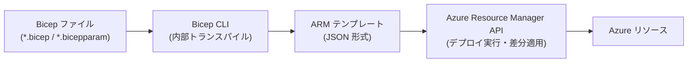
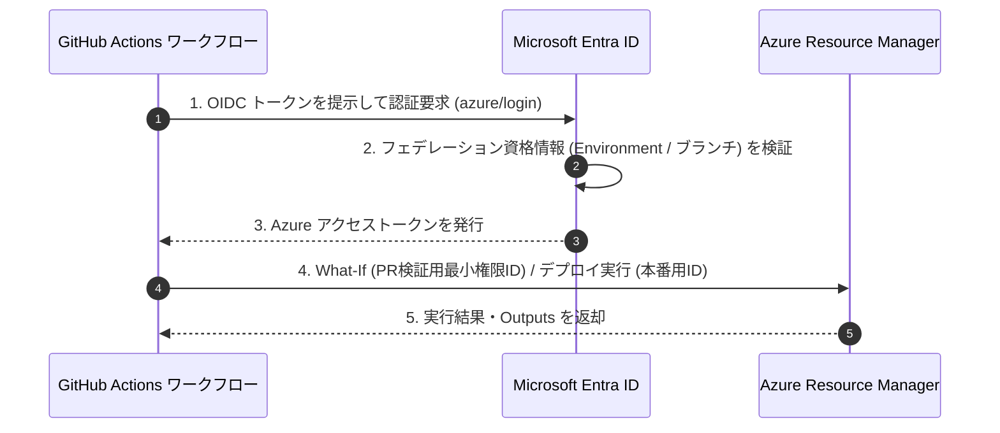

# Azure Bicep 学習資料

本資料は、Microsoft Azure のインフラストラクチャをコードとして定義・管理するドメイン固有言語（DSL）である **Azure Bicep** について、導入手順、基本構文、ビルド・デプロイ方法、GitHub Actions による自動化手順、および運用上の注意事項を整理したリファレンスです。

---

## 1. Bicep の概要と仕組み

[Azure Bicep](https://learn.microsoft.com/azure/azure-resource-manager/bicep/overview) は、Azure リソースを宣言的にデプロイするためのドメイン固有言語（DSL）です。Azure Resource Manager（ARM）テンプレート（JSON 形式）の抽象化レイヤーとして動作します。



### 主な特性

* **ARM テンプレートへのトランスパイル**: `.bicep` ファイルはデプロイ時に Bicep CLI によって標準の ARM テンプレート（JSON）へ変換され、Azure Resource Manager API に送信されます。
* **状態ファイル（State File）が不要**: Terraform の `.tfstate` のような外部状態ファイルを管理する必要がなく、Azure 上のリソースの現在の状態と直接比較されます。
* **Azure API の即時利用（Day 0 サポート）**: 新しい Azure リソースタイプや API バージョン（プレビュー版を含む）が公開されると、ツール側の更新を待たずに同じリソースプロバイダー定義を記述してデプロイできます。ただし、Bicep コンパイラにまだ型定義が組み込まれていない新しいリソースタイプや API バージョンを使用する場合は、デプロイ自体は可能ですがコンパイル時のプロパティ事前検証は行われません（警告 [`BCP081`](https://learn.microsoft.com/azure/azure-resource-manager/bicep/diagnostics/bcp081) が表示されます）。
* **型安全性と静的解析**: 型定義が提供されているリソースタイプと API バージョンについては、スキーマ検証および Linter による構文チェックがコンパイル時に行われます。

---

## 2. 導入・インストール

Bicep の利用には、記述・編集を行う「オーサリング環境」と、ビルドやデプロイを実行する「CLI 環境」を準備します。

### 2-1. オーサリング環境（VS Code 拡張機能）

Visual Studio Code を使用する場合、公式の **Bicep 拡張機能** を導入します。

* **拡張機能 ID**: [`ms-azuretools.vscode-bicep`](https://marketplace.visualstudio.com/items?itemName=ms-azuretools.vscode-bicep)
* **提供機能**:
  * リソースタイプ、API バージョン、プロパティの入力補完（IntelliSense）
  * スキーマに基づくリアルタイムの型検証と Linter 警告表示
  * リソース間の依存関係を視覚化する **Bicep Visualizer**
  * ARM テンプレート（JSON）断片をコピー＆ペーストした際の Bicep 構文への自動変換

```bash
# VS Code CLI から拡張機能をインストールする場合
code --install-extension ms-azuretools.vscode-bicep
```

### 2-2. CLI 実行環境のインストール

普段使用するコマンドラインツール（Azure CLI または Azure PowerShell）に合わせて導入します。

=== "Azure CLI を使用する場合"

    Azure CLI（バージョン 2.20.0 以降）には Bicep CLI の管理コマンドが組み込まれています。`az deployment` コマンドの実行時に Bicep CLI が未導入であれば自動的にインストールされますが、明示的に導入・更新する場合は以下のコマンドを実行します。

    ```bash
    # Bicep CLI のインストール
    az bicep install

    # インストール済みバージョンの確認
    az bicep version

    # 最新バージョンへの更新
    az bicep upgrade
    ```

=== "スタンドアロン / Azure PowerShell を使用する場合"

    Azure PowerShell（`Az.Resources` モジュール 5.6.0 以降）から Bicep を扱う場合、Bicep CLI は自動インストールされないため、スタンドアロンバイナリをインストールして環境変数 `PATH` に通す必要があります。

    ```powershell
    # Windows (winget)
    winget install -e --id Microsoft.Bicep

    # macOS (Homebrew)
    brew tap azure/bicep
    brew install bicep

    # バージョン確認
    bicep --version
    ```

---

## 3. 記述方法・基本構文

Bicep で使用する主なファイルの種類は以下の通りです。

| 拡張子 / ファイル名 | 役割 |
| :--- | :--- |
| `*.bicep` | リソース、モジュール、パラメータ、変数、出力などを記述するテンプレート本体。 |
| `*.bicepparam` | 環境ごとのパラメータ値を定義する Bicep 専用パラメータファイル（JSON 形式の `.parameters.json` も引き続き利用可能）。 |
| `bicepconfig.json` | Linter ルールのカスタマイズ、モジュールレジストリのエイリアス定義などを記述する設定ファイル。 |

### 3-1. ターゲットスコープ (`targetScope`)

ファイルの先頭でデプロイ先のスコープを宣言します。省略した場合の既定値は `'resourceGroup'` です。

```bicep
// 指定可能な値: 'resourceGroup' (既定) | 'subscription' | 'managementGroup' | 'tenant'
targetScope = 'resourceGroup'
```

### 3-2. パラメータ (`param`) とデコレーター

デプロイ時に外部から注入する値を定義します。デコレーター（`@`）を用いて制約や説明を付与できます。

```bicep
@description('デプロイ先のリージョン')
param location string = resourceGroup().location

@description('環境識別子')
@allowed([
  'dev'
  'stg'
  'prod'
])
param environmentName string = 'dev'

@description('ストレージアカウント名（3〜24文字の英小文字と数字）')
@minLength(3)
@maxLength(24)
param storageAccountName string

@description('管理者パスワード（デプロイ履歴やログに出力しない機密値）')
@secure()
param adminPassword string
```

主なデータ型は以下の通りです。

* `string`: 文字列
* `int`: 整数
* `bool`: 真偽値（`true` / `false`）
* `object`: オブジェクト（キーと値のペア）
* `array`: 配列

### 3-3. ユーザー定義データ型 (`type`)

構造化されたオブジェクトや許可リストの型を `type` キーワードで定義し、複数のパラメータや出力で再利用できます。`@export()` を付与すると他の `.bicep` ファイルから `import` 可能です。

```bicep
@export()
type storageSkuType = 'Standard_LRS' | 'Standard_ZRS' | 'Standard_GRS'

@export()
type appConfigType = {
  @description('アプリケーション名')
  name: string
  @description('インスタンス数')
  @minValue(1)
  @maxValue(10)
  instanceCount: int
  @description('任意タグ（省略可能プロパティはプロパティ名に ?: を指定）')
  tags?: object
}

param storageSku storageSkuType = 'Standard_LRS'
param appConfig appConfigType
```

* **省略可能プロパティ（`tags?: object`）と Null 許容型（`object?`）の違い**:
  * `tags?: object` のようにプロパティ名の末尾に `?` を付けると、オブジェクト内でそのプロパティ自体の記述を省略できます。
  * `object?` のように型名の末尾に `?` を付ける指定は、`null` 値の代入を許容する（Nullable）という意味になります。

### 3-4. 変数 (`var`)

テンプレート内で算出する値や、複数箇所で参照する固定オブジェクトを定義します。

```bicep
var uniqueSuffix = uniqueString(resourceGroup().id)
var defaultTags = {
  Environment: environmentName
  ManagedBy: 'Bicep'
}
```

### 3-5. リソース定義 (`resource`)

Azure リソースを定義する基本ブロックです。

```bicep
// 構文: resource <シンボリック名> '<プロバイダー>/<リソースタイプ>@<APIバージョン>' = { ... }
resource storageAccount 'Microsoft.Storage/storageAccounts@2023-05-01' = {
  name: storageAccountName
  location: location
  tags: defaultTags
  sku: {
    name: storageSku
  }
  kind: 'StorageV2'
  properties: {
    accessTier: 'Hot'
    minimumTlsVersion: 'TLS1_2'
    allowBlobPublicAccess: false
    supportsHttpsTrafficOnly: true
  }
}
```

* **シンボリック名（例：`storageAccount`）**: Bicep ファイル内でこのリソースを参照するための識別子であり、Azure 上のリソース名ではありません。
* **Azure 上のリソース名**: ブロック内の `name` プロパティで指定します。
* **依存関係の自動解決**: 別のリソースのプロパティで `storageAccount.id` や `storageAccount.properties.primaryEndpoints.blob` のようにシンボリック名を参照すると、トランスパイル時に自動的に `dependsOn` が生成されます。明示的な `dependsOn` の記述は、プロパティ参照が存在しない場合にのみ使用します。

#### 既存リソースの参照 (`existing`)

Bicep テンプレート外で作成済みのリソース（または別モジュールで作成されたリソース）の ID やプロパティを参照する場合は、`existing` キーワードを使用します。

```bicep
// 同一リソースグループ内の既存 VNet を参照
resource existingVnet 'Microsoft.Network/virtualNetworks@2023-11-01' existing = {
  name: 'vnet-shared-prod'
  // 別リソースグループにある場合は scope を指定
  // scope: resourceGroup('rg-network-prod')
}
```

#### 子リソースと拡張リソースの定義

* **子リソース（Child Resource）**: 親リソースの内部にネストするか、トップレベルで `parent` プロパティを指定して定義します。
* **拡張リソース（Extension Resource）**: RBAC ロール割り当て（`roleAssignments`）や診断設定（`diagnosticSettings`）、リソースロック（`locks`）など、対象リソースに紐付けるリソースは `scope` プロパティに対象リソースのシンボリック名を指定します。

```bicep
// 子リソースの例（Storage Account 配下の Blob Service と Container）
resource blobServices 'Microsoft.Storage/storageAccounts/blobServices@2023-05-01' = {
  parent: storageAccount
  name: 'default'
}

resource appContainer 'Microsoft.Storage/storageAccounts/blobServices/containers@2023-05-01' = {
  parent: blobServices
  name: 'appdata'
  properties: {
    publicAccess: 'None'
  }
}

// 拡張リソースの例（Storage Account に対するリソースロックの適用）
resource deleteLock 'Microsoft.Authorization/locks@2020-05-01' = {
  name: 'lock-storage-delete'
  scope: storageAccount
  properties: {
    level: 'CanNotDelete'
    notes: '誤削除防止ロック'
  }
}
```

### 3-6. 条件分岐とループ

```bicep
param createDiagnostics bool = true
param subnetNames array = [
  'snet-web'
  'snet-app'
  'snet-db'
]

// 条件付きデプロイ (if)
resource lock 'Microsoft.Authorization/locks@2020-05-01' = if (environmentName == 'prod') {
  name: 'prod-cannot-delete'
  scope: storageAccount
  properties: {
    level: 'CanNotDelete'
  }
}

// ループによる複数リソース作成 (for)
resource containers 'Microsoft.Storage/storageAccounts/blobServices/containers@2023-05-01' = [
  for (name, index) in subnetNames: {
    parent: blobServices
    name: 'container-${index}-${name}'
  }
]
```

### 3-7. モジュール (`module`)

複雑なテンプレートを機能単位に分割し、再利用するための仕組みです。ローカルファイルのほか、Azure Container Registry（プライベートレジストリ）や Microsoft 公式の **Azure Verified Modules (AVM)** を参照できます。

```bicep
// ローカルモジュールの呼び出し例（name プロパティは省略可能）
module appServiceModule './modules/appService.bicep' = {
  // 別リソースグループへデプロイする場合は scope を指定可能
  // scope: resourceGroup('rg-app')
  params: {
    location: location
    appName: 'app-web-${uniqueSuffix}'
    storageAccountId: storageAccount.id
  }
}

// モジュールの output 値の参照
var webAppHostName = appServiceModule.outputs.defaultHostName
```

* **`name` プロパティ（省略可能）**: モジュールは内部的に入れ子のデプロイ（`Microsoft.Resources/deployments`）へ変換されます。`name` プロパティは省略可能であり、省略した場合は一意なデプロイ名（GUID ベース）が自動生成されます。明示的に `name` を指定する場合は、同一スコープでのデプロイ名衝突を避けるため `${deployment().name}-appService` のように一意な名前を付与します。

### 3-8. 出力 (`output`)

デプロイ完了後に値を取り出す場合や、モジュールから呼び出し元のテンプレートへ値を渡す場合に使用します。

```bicep
output storageAccountId string = storageAccount.id
output blobEndpoint string = storageAccount.properties.primaryEndpoints.blob

// 機密値の出力（Bicep CLI 0.35.1 以降、string または object 型のみ対応）
@secure()
output generatedSecretObject object = {
  endpoint: storageAccount.properties.primaryEndpoints.blob
}
```

### 3-9. パラメータファイル (`.bicepparam`)

`.bicepparam` ファイル（Bicep CLI 0.18.4 以降 / Azure CLI 2.47.0 以降）は、`using` ステートメントで対象の `.bicep` ファイルを紐付け、型検査と入力補完が効く状態でパラメータを記述できます。

```bicep
// main.dev.bicepparam
using './main.bicep'

param environmentName = 'dev'
param storageAccountName = 'stmyappdev001'
param storageSku = 'Standard_LRS'
param appConfig = {
  name: 'myapp-dev'
  instanceCount: 2
}

// 環境変数からの値の読み取りも可能
// param adminPassword = readEnvironmentVariable('ADMIN_PASSWORD')
```

---

## 4. ビルド・検証・関連コマンド

### 4-1. ビルドの要否

Azure CLI（`az deployment` / `az stack`）や Azure PowerShell（`New-Az*Deployment`）を使用してデプロイする場合、コマンド実行時に内部で Bicep から ARM JSON への変換が自動的に行われます。そのため、**通常のデプロイ作業において手動で `.json` ファイルをビルド・コミットする必要はありません**。

手動でのビルドや検証コマンドは、主に以下の用途で使用します。

* CI パイプラインでの構文検証・Linter チェック
* 生成される ARM テンプレート（JSON）の構造確認・デバッグ
* ARM JSON 形式のみを受け付ける外部システムへの連携

### 4-2. 主要な Bicep CLI コマンド

```bash
# 1. Linter による静的解析と構文チェック（JSON ファイルは出力しない）
az bicep lint --file main.bicep

# 2. Bicep ファイルから ARM テンプレート (main.json) へのビルド
az bicep build --file main.bicep

# 3. .bicepparam ファイルから JSON パラメータファイル (main.dev.json) へのビルド
az bicep build-params --file main.dev.bicepparam

# 4. Bicep ファイルのコードフォーマット整形
az bicep format --file main.bicep

# 5. 既存の ARM テンプレート (JSON) から Bicep ファイルへのデコンパイル（逆変換）
az bicep decompile --file template.json
```

### 4-3. `bicepconfig.json` による Linter 設定

プロジェクトのルート（または対象の `.bicep` ファイルの親ディレクトリ）に `bicepconfig.json` を配置することで、Linter ルールの厳格度（`error` / `warning` / `info` / `off`）やモジュールエイリアスを制御できます。

```json
{
  "analyzers": {
    "core": {
      "enabled": true,
      "rules": {
        "no-unused-params": {
          "level": "warning"
        },
        "no-hardcoded-location": {
          "level": "error"
        },
        "secure-secrets-in-params": {
          "level": "error"
        }
      }
    }
  }
}
```

---

## 5. デプロイ方法

### 5-1. 事前確認（What-If 操作）

デプロイを実行する前に、`what-if` コマンドを使用して「現在の Azure 環境の状態」と「Bicep テンプレートの定義」を比較し、作成・変更・削除されるリソースのプレビューを確認できます。

`using './main.bicep'` を含む `.bicepparam` ファイルを使用する場合（Azure CLI 2.53.0 以降 / Bicep CLI 0.22.X 以降）、リンク先の `.bicep` ファイルが自動解決されるため `--template-file` の指定は不要であり、`--parameters` のみを指定します。

```bash
az deployment group what-if \
  --resource-group rg-myapp-dev \
  --parameters main.dev.bicepparam
```

!!! note "検証レベル（`--validation-level`）の指定"
    既定の What-If 操作（`--validation-level Provider`）は、デプロイ対象リソースへの書き込み権限と `Microsoft.Resources/deployments/*` 権限（デプロイ実行と同等の権限）を必要とします。Azure CLI 2.76.0 以降（Azure PowerShell 13.4.0 以降）では `--validation-level ProviderNoRbac` を指定することで、書き込み権限を持たない閲覧者（Reader）相当の権限で What-If 検証を実行できます。

### 5-2. スコープ別のデプロイコマンド

テンプレートの `targetScope` に応じて、対応するデプロイコマンドを実行します。`using` ステートメントを含む `.bicepparam` を渡す場合は `--parameters` のみを指定します（JSON パラメータファイル `.parameters.json` や `using none` の `.bicepparam` を使用する場合は `--template-file <file>.bicep` を併用します）。

=== "リソースグループ スコープ"

    ```bash
    # 事前にリソースグループが存在している必要があります
    az group create --name rg-myapp-dev --location japaneast

    # リソースグループへのデプロイ（using を含む .bicepparam 指定時）
    az deployment group create \
      --resource-group rg-myapp-dev \
      --parameters main.dev.bicepparam
    ```

=== "サブスクリプション スコープ"

    ```bash
    # リソースグループ自体の作成を含むテンプレートなどで使用
    az deployment sub create \
      --location japaneast \
      --parameters main-sub.dev.bicepparam
    ```

=== "管理グループ / テナント スコープ"

    ```bash
    # 管理グループへのデプロイ
    az deployment mg create \
      --management-group-id mg-landingzones \
      --location japaneast \
      --parameters main-mg.bicepparam

    # テナントへのデプロイ
    az deployment tenant create \
      --location japaneast \
      --parameters main-tenant.bicepparam
    ```

!!! note "コマンドラインからの個別パラメータ上書き"
    `--parameters` にはパラメータファイルと個別の `key=value` 指定を併用できます。ファイル指定の後に個別パラメータを記述すると、ファイル内の値を上書きできます。

### 5-3. デプロイモードとデプロイ スタック（Deployment Stacks）

通常の `az deployment` には「増分モード（Incremental：既定）」と「完全モード（Complete）」がありますが、増分モードでは**テンプレートからリソース定義を削除しても Azure 上の実リソースは削除されません**。一方、完全モードは段階的に非推奨（Deprecated）となっており、Microsoft 公式ドキュメントでは Bicep / ARM テンプレートのデプロイでリソースの削除を行う場合に **[デプロイ スタック（Deployment Stacks）](https://learn.microsoft.com/azure/azure-resource-manager/bicep/deployment-stacks)** を使用することが推奨されています。

```bash
# デプロイ スタックの作成・更新（リソースグループ スコープ・.bicepparam 指定の例）
az stack group create \
  --name stack-myapp-dev \
  --resource-group rg-myapp-dev \
  --parameters main.dev.bicepparam \
  --action-on-unmanage deleteResources \
  --deny-settings-mode none \
  --yes
```

* `--action-on-unmanage`: テンプレートから削除された（管理対象外となった）リソースの扱いを指定します。
  * `deleteResources`: リソースを削除する（リソースグループ自体は残す）
  * `deleteAll`: リソースおよび管理対象のリソースグループを削除する
  * `detachAll`: Azure 上のリソースは削除せず、スタックの管理対象から切り離す
* `--deny-settings-mode`: スタック外の手動操作等による変更や削除を拒否する設定（`none` / `denyDelete` / `denyWriteAndDelete`）を指定します。

---

## 6. GitHub Actions でデプロイする際の一般的な方法

GitHub Actions から Azure へ Bicep をデプロイする場合、クライアントシークレット（パスワード）を保存しない **OpenID Connect (OIDC) によるワークロード ID フェデレーション** を構成するのが標準的な手順です。



### 6-1. 事前準備（ID の分離・最小権限・環境保護ルール）

既定の What-If 操作にもデプロイ相当の権限が必要となるため、プルリクエスト（マージ前のコード）で本番デプロイ用の高権限 ID をそのまま使用すると、PR 内でテンプレートやワークフローを書き換えて本番環境へ変更を加えられるリスクがあります。そのため、**PR 検証用の ID と本番デプロイ用の ID（および GitHub Environments）を分離**します。

1. **ID の作成と RBAC ロールの割り当て**:
   * **PR 検証用 ID（ユーザー割り当てマネージド ID またはサービスプリンシパル）**:
     * `--validation-level ProviderNoRbac`（Azure CLI 2.76.0 以降）を利用する場合、対象スコープの `閲覧者（Reader）` ロールに加え、`Microsoft.Resources/deployments/whatIf/action` および `Microsoft.Resources/deployments/validate/action` のみを許可したカスタムロール（最小権限）を割り当てます（または検証専用リソースグループへの権限に限定します）。
   * **本番デプロイ用 ID**:
     * デプロイ先のリソースグループ（またはサブスクリプション）に対して、実リソースの作成・更新に必要なロール（例：`共同作成者` や対象リソース固有のロール、デプロイ スタック利用時は `Azure Deployment Stack 共同作成者` 等）を割り当てます。
2. **フェデレーション資格情報（Federated Credentials）の登録**:
   * PR 検証用 ID には、GitHub Environment `pr-validation`（または `pull_request` エンティティ）に対応するフェデレーション資格情報を構成します。
   * 本番デプロイ用 ID には、GitHub Environment `production`（またはブランチ `refs/heads/main`）のみを信頼するフェデレーション資格情報を構成します。
3. **GitHub Environments の保護ルールとシークレット設定**:
   * GitHub リポジトリの **Settings > Environments** で `pr-validation` と `production` を作成します。
   * **`production` 環境の保護設定**:
     * **Required reviewers（必須承認者）**: 本番デプロイ実行前の手動承認を有効化します。
     * **Deployment branches and tags**: デプロイ元ブランチを `main` ブランチのみに制限します。
   * 各 Environment の Secrets（または Variables）に、それぞれの ID に対応する `AZURE_CLIENT_ID`、`AZURE_TENANT_ID`、`AZURE_SUBSCRIPTION_ID` を登録します。

### 6-2. ワークフロー定義例（`.github/workflows/deploy-bicep.yml`）

プルリクエスト時に最小権限 ID で `lint` と `what-if`（`.bicepparam` を指定）を実行し、`main` ブランチへのプッシュ時に承認を経て本番用 ID でデプロイを実行する構成例です。

```yaml
name: Deploy Bicep Infrastructure

on:
  push:
    branches:
      - main
    paths:
      - 'infra/**'
      - '.github/workflows/deploy-bicep.yml'
  pull_request:
    branches:
      - main
    paths:
      - 'infra/**'

# OIDC トークン取得のために id-token: write が必須
permissions:
  id-token: write
  contents: read

env:
  AZURE_RESOURCE_GROUP: rg-myapp-prod
  BICEP_FILE_PATH: infra/main.bicep
  BICEP_PARAM_PATH: infra/main.prod.bicepparam

jobs:
  validate-and-what-if:
    name: Lint & What-If (PR Validation)
    runs-on: ubuntu-latest
    # PR 検証用の最小権限 ID が紐付いた Environment を使用
    environment: pr-validation
    steps:
      - name: Checkout repository
        uses: actions/checkout@v4

      - name: Bicep Lint Check
        run: az bicep lint --file ${{ env.BICEP_FILE_PATH }}

      - name: Azure Login (OIDC - PR Validation Identity)
        uses: azure/login@v2
        with:
          client-id: ${{ secrets.AZURE_CLIENT_ID }}
          tenant-id: ${{ secrets.AZURE_TENANT_ID }}
          subscription-id: ${{ secrets.AZURE_SUBSCRIPTION_ID }}

      - name: Run What-If with .bicepparam
        run: |
          az deployment group what-if \
            --resource-group ${{ env.AZURE_RESOURCE_GROUP }} \
            --parameters ${{ env.BICEP_PARAM_PATH }} \
            --validation-level ProviderNoRbac

  deploy:
    name: Deploy to Azure (Production)
    needs: validate-and-what-if
    if: github.ref == 'refs/heads/main' && github.event_name == 'push'
    runs-on: ubuntu-latest
    # 必須承認者と main ブランチ制限を設定した本番用 Environment を使用
    environment: production
    steps:
      - name: Checkout repository
        uses: actions/checkout@v4

      - name: Azure Login (OIDC - Production Identity)
        uses: azure/login@v2
        with:
          client-id: ${{ secrets.AZURE_CLIENT_ID }}
          tenant-id: ${{ secrets.AZURE_TENANT_ID }}
          subscription-id: ${{ secrets.AZURE_SUBSCRIPTION_ID }}

      - name: Deploy Bicep with .bicepparam
        run: |
          az deployment group create \
            --resource-group ${{ env.AZURE_RESOURCE_GROUP }} \
            --parameters ${{ env.BICEP_PARAM_PATH }}
```

!!! note "`azure/bicep-deploy@v2` アクションやデプロイ スタックを使用する場合"
    専用の GitHub Action を使用する場合は、`.bicepparam` やデプロイ スタック（`type: deploymentStack`）に対応した [`azure/bicep-deploy@v2`](https://github.com/Azure/bicep-deploy) を利用するか、上記のように Azure CLI で `az stack group create --name <stack-name> --resource-group ${{ env.AZURE_RESOURCE_GROUP }} --parameters ${{ env.BICEP_PARAM_PATH }} --action-on-unmanage deleteResources --deny-settings-mode none --yes` を実行します。

---

## 7. 関連情報（参考サイト・注意事項）

### 7-1. 文法・設計の参考サイト

| サイト名 | 内容・用途 |
| :--- | :--- |
| **[Bicep のドキュメント (Microsoft Learn)](https://learn.microsoft.com/azure/azure-resource-manager/bicep/)** | Bicep の公式ドキュメント。言語仕様、関数リファレンス（文字列・配列・スコープ関数など）、ベストプラクティスが網羅されている。 |
| **[Azure テンプレート リファレンス (Microsoft Learn)](https://learn.microsoft.com/azure/templates/)** | 全 Azure リソースの Bicep / ARM テンプレートのスキーマ定義一覧。各リソースタイプの API バージョンごとの必須プロパティや型を確認する際に参照する。 |
| **[Azure Verified Modules (AVM)](https://azure.github.io/Azure-Verified-Modules/)** | Microsoft がメンテナンスする公式の標準 Bicep（および Terraform）モジュール群。Well-Architected Framework に準拠した構成例やモジュール呼び出し元として利用できる。 |
| **[Bicep Playground](https://aka.ms/bicepdemo)** | ブラウザ上で Bicep コードと ARM テンプレート（JSON）の相互変換やサンプルテンプレートの確認ができる公式 Web ツール。 |
| **[GitHub - Azure/bicep](https://github.com/Azure/bicep)** | Bicep コンパイラ・CLI・VS Code 拡張機能の開発リポジトリ。リリースノートや新機能・実験的機能の仕様確認に利用する。 |

### 7-2. 実装・運用上の注意事項

#### 1. 機密情報（シークレット・アクセスキー）の取り扱いと `@secure()` 出力の制約

* **パラメータへの `@secure()` 付与**: パスワードや API キーを受け取るパラメータには必ず `@secure()` デコレーターを付与します。付与しない場合、Azure Portal のデプロイ履歴から平文で値が閲覧可能になります。また、`.bicepparam` ファイルに平文で機密値を記述せず、[Key Vault からの `getSecret()` 取得](https://learn.microsoft.com/azure/azure-resource-manager/bicep/key-vault-parameter)を使用します。
* **機密値の受け渡しにおける推奨方式（Key Vault / マネージド ID）**: ストレージアカウントや Cosmos DB などの `listKeys()` 関数の結果を通常の `output` に出力すると、デプロイ履歴にキーが平文で記録されます。まずアクセスキーを使わず **マネージド ID と Azure RBAC** で認証する構成を優先し、機密値の保存や受け渡しが必要な場合は **Azure Key Vault** にシークレットとして格納して参照する構成が推奨されます。
* **`@secure()` 付き `output` のバージョン要件と制約**:
  * **バージョン要件**: 出力への `@secure()` デコレーター付与は **Bicep CLI バージョン 0.35.1 以降** でサポートされています。
  * **型の制約**: ARM テンプレートの `secureString` / `secureObject` 型に対応するため、適用対象は **`string` 型または `object` 型の出力のみ** です（配列や整数を保護する場合は `object` でラップするか文字列へシリアル化する必要があります）。
  * **値取得の制約**: `@secure()` を付与した出力はデプロイ履歴やコマンドライン出力に記録・表示されないため、デプロイ完了後に `az deployment group show` 等で履歴から値を取得することはできません（主にモジュールから親テンプレートへメモリ上で安全に値を渡す用途に限定されます）。

#### 2. べき等性（Idempotency）とリソース名の決定論的生成

* Storage Account、Key Vault、Container Registry、App Service などは Azure 全体（グローバル）で一意な名前が必要です。
* リソース名の一意性を確保する際は、`uniqueString(resourceGroup().id)` のように**何度デプロイしても同じ入力から同じ文字列が生成される関数**を使用します。毎回異なる値が生成される方法（デプロイごとに日時や乱数を注入する等）をリソース名に使うと、再デプロイのたびに別名の新規リソースが作成されます。

#### 3. デプロイ名（`deployment.name`）の衝突とデプロイ履歴上限

* `az deployment` 実行時に `--name` を省略すると、ファイル名（例：`main` やパラメータファイル名）がデプロイ名として使用されます。
* Bicep 内の `module` ブロックにおける `name` プロパティ（入れ子デプロイの名前）は**省略可能**です。`name` を省略した場合は Bicep コンパイラによって一意なデプロイ名が自動生成されます（Linter ルール [`no-module-name`](https://learn.microsoft.com/azure/azure-resource-manager/bicep/linter-rule-no-module-name) で明示的な指定を警告することも可能です）。
* 一方、`az deployment` や `module` で固定のデプロイ名を明示的に指定した場合、同一スコープ内で同名デプロイが並行実行されると競合エラーになり、順次実行された場合は過去のデプロイ履歴が上書きされます。明示的に指定する場合は `${deployment().name}-subnet-${index}` のように一意となる名前を付けます。
* リソースグループのデプロイ履歴は上限（800件）に近づくと古い履歴から自動削除されますが、短時間に大量のデプロイを行う環境では履歴件数にも留意が必要です。

#### 4. リソース削除の挙動（Deployment Stacks の利用）と論理削除（Soft Delete）からの復元

* **リソース削除には Deployment Stacks を推奨（Complete モードの段階的非推奨）**: `az deployment group create` の既定である増分（Incremental）モードでは、`.bicep` ファイルからリソース定義を削除しても Azure 上のリソースは残ります。また、従来の完全（Complete）モードは段階的に非推奨となっているため、テンプレートからの削除に合わせて実リソースを削除する場合は **[デプロイ スタック（Deployment Stacks / `az stack`）](https://learn.microsoft.com/azure/azure-resource-manager/bicep/deployment-stacks)** を使用します。
* **論理削除（Soft Delete）されたリソースの復元・消去手順（サービス別の違い）**:
  論理削除が有効なリソースを削除した直後は、一定期間内部的に保持されるため、同名のまま新規作成しようとすると競合エラーになります。復元（Recover）または完全消去（Purge）の手順はサービスごとに異なります。
  * **[Azure Key Vault の場合](https://learn.microsoft.com/azure/key-vault/general/key-vault-recovery)**:
    * **復元**: Azure CLI の `az keyvault recover --name <vault-name>`（PowerShell は `Undo-AzKeyVaultRemoval`）または Azure Portal の［削除されたコンテナーの管理］から復元します（Bicep 定義側では Key Vault 固有プロパティとして `properties.createMode: 'recover'` も存在します）。
    * **完全消去**: パージ保護（Purge Protection）が無効な場合は `az keyvault purge --name <vault-name>` で完全消去できます。パージ保護が有効な場合は保持期間が経過するまで消去できないため、同じ名前を使用するには既存コンテナーを復元する必要があります。
  * **[Azure OpenAI / Microsoft Foundry リソース（`Microsoft.CognitiveServices/accounts`）の場合](https://learn.microsoft.com/azure/ai-services/recover-purge-resources)**:
    * **復元**: 削除後48時間以内であれば、Azure Portal の［削除されたリソースの管理］、または Azure CLI（`az resource create -g <rg> -n <name> --location <location> --namespace Microsoft.CognitiveServices --resource-type accounts --properties "{\"restore\": true}"`）や Bicep のリソース `properties` に `restore: true` を指定して復元します（Key Vault のような `createMode: 'recover'` ではありません）。
    * **完全消去**: 同名で新規作成し直す場合やプロビジョニング済みデプロイの課金を即座に停止する場合は、`az resource delete --ids /subscriptions/<sub-id>/providers/Microsoft.CognitiveServices/locations/<location>/resourceGroups/<rg>/deletedAccounts/<name>`（または Portal の［削除されたリソースの管理］）から消去（Purge）を実行します。

#### 5. 型情報を持たない新しいリソース型・API バージョン（`BCP081`）

* リリース直後の新しいリソースタイプや最新のプレビュー API バージョンなど、Bicep コンパイラにまだ型定義（スキーマ情報）が含まれていないものを指定した場合、Linter 警告 **[`BCP081`](https://learn.microsoft.com/azure/azure-resource-manager/bicep/diagnostics/bcp081)（リソースの種類には使用できる型がありません）** が表示されます。
* この警告が出ていても ARM テンプレートへの変換およびデプロイはブロックされませんが、**デプロイ前に Bicep 側でリソースプロパティの型検証や必須プロパティのチェックを行うことができない**ため、[Azure テンプレート リファレンス](https://learn.microsoft.com/azure/templates/) や REST API 仕様でプロパティ構造を直接確認する必要があります（リソース名や API バージョンの単なるタイプミスでも同じ `BCP081` が表示されるため、意図した API バージョンかどうかもあわせて確認します）。

#### 6. What-If の結果に含まれるノイズ

* `what-if` 操作は変更内容の事前確認に有効ですが、Azure Resource Manager API の仕様上、テンプレートで省略したプロパティに対して Azure 側で設定される既定値や、読み取り専用プロパティ、API バージョン差異などが「変更（Modify）」として表示される場合（ノイズ）があります。
* また、別モジュールの `output` に依存する一部の動的プロパティや `templateLink` はデプロイ実行時まで確定しないため、What-If 時点では未評価（ショートサーキット）となるケースがあります。

#### 7. 循環依存（Circular Dependency）の回避

* リソース A がリソース B のプロパティを参照し、同時にリソース B がリソース A のプロパティを参照すると、コンパイル時に循環依存エラーが発生します。
* この場合は、一方の設定（ロール割り当て、VNet ピアリング、診断設定、アプリ設定など）を独立した子リソースや拡張リソース、または別モジュールとして切り出し、両方のリソース作成後に適用される構造に分割します。

