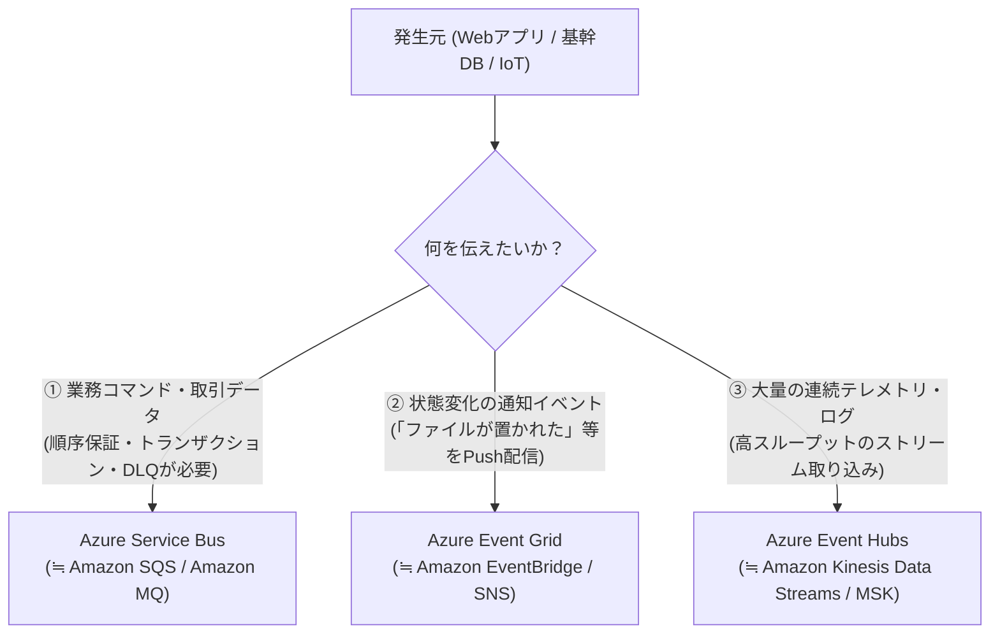

# データ基盤と SoR / SoE / SoI アーキテクチャ（DB・ストレージ・統合・分析）

エンタープライズシステムを設計する際、**SoR（記録のシステム）**、**SoE（顧客接点のシステム）**、**SoI（洞察のシステム）** の役割ごとにデータストアと連携基盤を使い分けます。
このページでは、各アーキテクチャ領域に対応するAzureのデータベース、ストレージ、メッセージング、およびデータ分析基盤を Microsoft Learn の公式情報に基づき AWS と比較して解説します。
（参考：[AWS プロフェッショナル向けのデータベース サービス - Microsoft Learn](https://learn.microsoft.com/azure/architecture/aws-professional/databases)）

---

## 1. データベースサービス（SoR & SoE の中核）

### 1-1. リレーショナルデータベース（主に SoR 領域）

AWSでは「RDS」とクラウドネイティブな「Aurora」という区分ですが、Azureでは **Microsoft SQL Server ベースの「Azure SQL」ファミリー** と、**OSSデータベースの「フレキシブル サーバー」ファミリー** に大別されます。

| カテゴリ | AWS サービス | Azure サービス | 特徴・提供条件とAWS経験者向け解説 |
| :--- | :--- | :--- | :--- |
| **クラウドネイティブ RDB (SQL Server系)** | Amazon RDS for SQL Server / Amazon Aurora | **[Azure SQL Database](https://learn.microsoft.com/azure/azure-sql/database/sql-database-paas-overview)** | フルマネージドなPaaS型SQLデータベース。自動一時停止に対応するサーバーレス計算レベルや、コンピュートとストレージを分離したアーキテクチャである **[Hyperscale サービスレベル](https://learn.microsoft.com/azure/azure-sql/database/service-tier-hyperscale)**（**単一データベースあたり最大 128 TB** まで自動拡張、ページサーバーによる高速なバックアップ・リストアとリードレプリカ作成に対応）を選択可能。 |
| **インスタンス単位のPaaS型 SQL Server** | Amazon RDS Custom / RDS for SQL Server | **[Azure SQL Managed Instance (SQL MI)](https://learn.microsoft.com/azure/azure-sql/managed-instance/sql-managed-instance-paas-overview)** | 既存のSQL Serverワークロードのクラウド移行（リフト＆シフト）に適したPaaS。SQL Server Agent、クロスデータベースクエリ、リンクサーバー、Service Brokerなどのインスタンスレベル機能をサポートする。 ⚠️ **注意点**：オンプレミスSQL Serverとの間に **[T-SQLや機能の相違点・未対応事項](https://learn.microsoft.com/azure/azure-sql/managed-instance/t-sql-sql-server-diff-index)**（OSやファイルシステムへの直接アクセス、一部のバックアップ・復元構文、Always On 可用性グループ関連のDMV/構文、FILESTREAM/FileTable等の制限）が存在するため、移行前に Azure Database Migration 拡張機能等を用いた**互換性評価（アセスメント）が必須**。 |
| **PostgreSQL** | Amazon RDS / Aurora PostgreSQL | **[Azure Database for PostgreSQL - フレキシブル サーバー](https://learn.microsoft.com/azure/postgresql/flexible-server/overview)** | OSSのPostgreSQLマネージドサービス。ゾーン冗長高可用性（HA）、リードレプリカ、**[pgvector 拡張や Azure AI 拡張機能](https://learn.microsoft.com/azure/postgresql/flexible-server/generative-ai-overview)** をサポート。 |
| **MySQL** | Amazon RDS / Aurora MySQL | **[Azure Database for MySQL - フレキシブル サーバー](https://learn.microsoft.com/azure/mysql/flexible-server/overview)** | OSSのMySQLマネージドサービス。ゾーン冗長HAやIOPSの自動スケーリングに対応。 |

### 1-2. NoSQL・インメモリキャッシュ（主に SoE & AI 領域）

| カテゴリ | AWS サービス | Azure サービス | 特徴・提供条件とAWS経験者向け解説 |
| :--- | :--- | :--- | :--- |
| **グローバル分散 NoSQL / マルチモデル** | Amazon DynamoDB / DocumentDB / Keyspaces / Neptune | **[Azure Cosmos DB](https://learn.microsoft.com/azure/cosmos-db/introduction)** | マルチリージョンレプリケーションと複数のデータモデルをサポートするマネージドデータベース。 ⚠️ **SLA条件とAPI選択の注意点**：99.999%可用性SLAや1桁ミリ秒遅延SLAには構成上の適用条件があり、またAPIはアカウント作成時に1つを選択する方式（同一アカウント内での混在不可）となっている。詳細はすぐ下の「1-3. Azure Cosmos DB のAPI選択とSLAの適用条件」を参照。 |
| **シンプルなKey-Valueストア** | Amazon SimpleDB / DynamoDB (簡易用途) | **[Azure Table Storage](https://learn.microsoft.com/azure/storage/tables/table-storage-overview)** | ストレージアカウント内で提供されるKey-Valueストア。単一リージョン（およびセカンダリ読み取りレプリカ）構成でコストを抑えて構造化データを保存する用途に向く。 |
| **インメモリキャッシュ** | Amazon ElastiCache (Redis / Valkey) | **[Azure Managed Redis](https://learn.microsoft.com/azure/redis/overview)** (および Azure Cache for Redis) | Redis社のRedis Enterprise技術を統合したマネージドキャッシュ。セッション管理、キャッシュ、ベクトル検索（RediSearch）、アクティブ・アクティブ地理レプリケーション（構成ティアに依存）に対応。 |

### 1-3. Azure Cosmos DB のAPI選択とSLAの適用条件

#### ① APIの選択（アカウント単位で固定・混在不可）
Azure Cosmos DB は複数のデータモデル・ワイヤプロトコルに対応していますが、**1つの Cosmos DB アカウント内で複数のAPIを自由に混在させることはできません**。アカウント作成時に以下のいずれかのAPIを選択する必要があり、選択したAPIによってデータモデル、課金体系（RUベース vs vCoreベース）、利用可能な機能が異なります。
（参考：[Azure Cosmos DB で適切な API を選択する - Microsoft Learn](https://learn.microsoft.com/azure/cosmos-db/choose-api)）

| API の選択肢 | データモデル・課金方式 | 主な用途・特徴 |
| :--- | :--- | :--- |
| **[API for NoSQL](https://learn.microsoft.com/azure/cosmos-db/nosql/introduction)** | ドキュメント (JSON) / RU (Request Units) 課金 | Cosmos DB のネイティブAPI。SQLライクなクエリ構文、Change Feed、自動インデックス、**[DiskANNベースの統合ベクトル検索](https://learn.microsoft.com/azure/cosmos-db/nosql/vector-search)** などの最新機能が最初に提供される。新規開発での推奨選択肢。 |
| **[API for MongoDB](https://learn.microsoft.com/azure/cosmos-db/mongodb/introduction)** | ドキュメント (BSON) / **vCoreベース** または **RUベース** | 既存のMongoDBアプリやドライバとの互換性を提供。なお、インスタンスベースの管理とベクトル検索等に馴染みやすい **vCore ベース（Azure DocumentDB アーキテクチャ）** と、スループット単位の **RU ベース** の2種類のアーキテクチャがあり、特性が大きく異なる。 |
| **[API for PostgreSQL](https://learn.microsoft.com/azure/cosmos-db/postgresql/introduction)** | リレーショナル + 分散テーブル / vCore課金 | PostgreSQLの **Citus 拡張** をベースにした水平分散リレーショナルDB。 |
| **[API for Apache Cassandra](https://learn.microsoft.com/azure/cosmos-db/cassandra/introduction)** | ワイドカラム / RU課金 | Cassandra CQL v4 ワイヤプロトコル互換。既存のCassandraワークロード移行向け。 |
| **[API for Apache Gremlin](https://learn.microsoft.com/azure/cosmos-db/gremlin/introduction)** | グラフ / RU課金 | Apache TinkerPop（Gremlin）ベースのグラフデータベース（AWSのAmazon Neptuneに相当）。 |
| **[API for Table](https://learn.microsoft.com/azure/cosmos-db/table/introduction)** | Key-Value / RU課金 | Azure Table Storage 互換のAPIで、グローバル分散や自動インデックスが必要な場合に使用。 |

#### ② 可用性（99.999%）とレイテンシ（1桁ミリ秒）のSLA適用条件
Cosmos DB の「99.999%可用性」や「1桁ミリ秒の応答」は**無条件ですべての構成に適用されるわけではなく、以下の条件を満たした場合にSLAの対象となります**。
（参考：[Azure Cosmos DB の高可用性 - Microsoft Learn](https://learn.microsoft.com/azure/cosmos-db/high-availability)）

* **可用性 SLA の条件**：
  * **99.999%（読み取りおよび書き込みの両方）**：**複数のAzureリージョンに展開し、かつ「マルチリージョン書き込み（Multi-region writes）」を有効にした構成**が条件です。
  * マルチリージョン構成で「単一リージョン書き込み」の場合は、読み取りが 99.999%、書き込みが 99.99% となります。
  * 単一リージョン構成の場合は、Availability Zones（AZ）有効時で 99.995%、AZ無効時で 99.99% です。
* **レイテンシ（遅延）SLA の条件**：
  * **99パーセンタイルで 10ミリ秒未満（読み取り・書き込み）**：API for NoSQL 等において、**同一Azureリージョン内のクライアントから Direct 接続モード（TCP）等の推奨SDK構成を使用し、プロビジョニング済みスループット（RU/s）の上限内で実行される 1 KB のインデックス付きレコード操作**が基準となります（インターネット経由の通信遅延や複雑な集計クエリは含まれません）。
* **5段階の一貫性レベル（Consistency Levels）**：
  * `Strong`（強） / `Bounded Staleness`（有界整合性制約） / `Session`（セッション：デフォルト） / `Consistent Prefix`（一貫性のあるプレフィックス） / `Eventual`（結果整合性）の5段階から選択でき、マルチリージョン構成時のレプリケーション遅延やトレードオフを制御します（[一貫性レベルの詳細 - Microsoft Learn](https://learn.microsoft.com/azure/cosmos-db/consistency-levels)）。

---

## 2. ストレージサービス

（参考：[AWS プロフェッショナル向けのストレージ サービス - Microsoft Learn](https://learn.microsoft.com/azure/architecture/aws-professional/storage)）

Azureでは、親リソースとして **[ストレージアカウント (Storage Account)](https://learn.microsoft.com/azure/storage/common/storage-account-overview)** を作成し、その中の機能（Blob, Files, Queue, Table）を利用します。

| カテゴリ | AWS サービス | Azure サービス | 特徴・提供条件とAWS経験者向け解説 |
| :--- | :--- | :--- | :--- |
| **オブジェクトストレージ** | Amazon S3 | **[Azure Blob Storage](https://learn.microsoft.com/azure/storage/blobs/storage-blobs-introduction)** | S3バケットは、Azureでは「ストレージアカウント内の**コンテナー**」に相当。アクセス層として **ホット (S3 Standard相当) / クール (S3 Standard-IA相当) / コールド (S3 Glacier Instant相当) / アーカイブ (S3 Glacier Deep Archive相当)** を提供。 |
| **ビッグデータ向けデータレイク** | Amazon S3 (Lake Formation) | **[Azure Data Lake Storage Gen2 (ADLS Gen2)](https://learn.microsoft.com/azure/storage/blobs/data-lake-storage-introduction)** | Blob Storage作成時に **「階層型名前空間 (Hierarchical Namespace)」を有効化**したもの。アトミックなディレクトリ操作（フォルダのリネーム等）とPOSIX準拠のACL権限管理が可能になり、SparkやMicrosoft Fabricからの分析処理に適している。 |
| **ブロックストレージ** | Amazon EBS | **[Azure Managed Disks](https://learn.microsoft.com/azure/virtual-machines/managed-disks-overview)** | VMにアタッチするディスク。Standard HDD / Standard SSD / Premium SSD (v1, v2) / Ultra Disk（AWSのio2 Block Express相当）がある。 |
| **マネージドファイル共有** | Amazon EFS / FSx for Windows | **[Azure Files](https://learn.microsoft.com/azure/storage/files/storage-files-introduction)** | マネージドファイル共有サービス。**SMB（2.1 / 3.x）** または **NFSv4.1** プロトコルを選択できる。 ⚠️ **制限事項**：**同一のファイル共有（File Share）でSMBとNFSを併用することはできない**。またプロトコルごとに要件・認証方式が異なる（詳細は下の補足を参照）。 |
| **エンタープライズNAS** | Amazon FSx for NetApp ONTAP | **[Azure NetApp Files (ANF)](https://learn.microsoft.com/azure/azure-netapp-files/azure-netapp-files-introduction)** | NetApp技術に基づくファーストパーティの高性能ファイルストレージ。SAP HANAやHPC、また**単一ボリュームでのデュアルプロトコル（SMBとNFSの同時アクセス）**が必要なワークロードにも対応。 |

> [!IMPORTANT]
> **Azure Files における SMB と NFS の違いと制限事項**
> （参考：[Azure Files の SMB と NFS の比較 - Microsoft Learn](https://learn.microsoft.com/azure/storage/files/storage-files-introduction)、[NFS Azure ファイル共有 - Microsoft Learn](https://learn.microsoft.com/azure/storage/files/storage-files-quick-create-use-linux)）
> 1. **同一ファイル共有でのプロトコル併用不可**：ファイル共有を作成する際に「SMB」か「NFS」のどちらか一方を指定する必要があり、同じファイル共有に対してSMBとNFSの両方でアクセスすることはできません（両方からの同時アクセスが必要な場合は [Azure NetApp Files のデュアルプロトコル ボリューム](https://learn.microsoft.com/azure/azure-netapp-files/azure-netapp-files-create-volumes-dual-protocol) を検討します）。
> 2. **ストレージティアの制限**：SMBは Standard（HDD）と Premium（SSD / `FileStorage` アカウント種類）の両方で利用できますが、**NFSv4.1 は Premium（SSD）ティアでのみサポート**されます（最小プロビジョニング容量は 100 GiB）。
> 3. **認証・セキュリティ制御の違い**：SMBは IDベース認証（オンプレミスAD DS、Microsoft Entra Domain Services、Microsoft Entra Kerberos）およびストレージアカウントキーによる認証に対応しています。一方、**NFSv4.1 はIDベース認証をサポートしておらず、ネットワークレベルのアクセス制御（Private Endpoint または VNet サービスエンドポイント）が必須**となります。また、NFSでの通信暗号化（Encryption in transit）にはクライアントへの `aznfs` マウントヘルパー（Stunnelラッパー）の導入が必要です。

---

## 3. メッセージング・イベント駆動・統合基盤（SoR ⇔ SoE ⇔ SoI の疎結合連携）

Azureでは、運ぶデータの性質（**業務メッセージ・イベント通知・連続ストリーム**）によって3つのサービスを使い分けます。
（参考：[メッセージング サービスの選択 - Microsoft Learn](https://learn.microsoft.com/azure/architecture/guide/technology-choices/messaging)）

| カテゴリ | AWS サービス | Azure サービス | 特徴と使い分けのポイント |
| :--- | :--- | :--- | :--- |
| **エンタープライズ・メッセージブローカー** | Amazon SQS / Amazon SNS (FIFO) / Amazon MQ | **[Azure Service Bus](https://learn.microsoft.com/azure/service-bus-messaging/service-bus-messaging-overview)** | 1対1の「キュー (Queue)」と、1対多のPub/Subを行う「トピック (Topic) とサブスクリプション（Basicティア除く）」を提供。重複排除、セッションによるFIFO順序保証、トランザクション処理、デッドレターキュー（DLQ）を備え、SoRの注文処理や決済連携に適している。 |
| **軽量メッセージキュー** | Amazon SQS (Standardの簡易用途) | **[Azure Queue Storage](https://learn.microsoft.com/azure/storage/queues/storage-queues-introduction)** | ストレージアカウントに含まれるシンプルなキュー（1メッセージ最大64 KB）。大容量（ストレージアカウント上限まで）のバックログを低コストで保持したいバッチ処理向け。 |
| **イベントルーター** | Amazon EventBridge / Amazon SNS | **[Azure Event Grid](https://learn.microsoft.com/azure/event-grid/overview)** | イベント駆動（Pub/Sub / Push配信またはPull配信）のルーター。Blobへのファイル追加などのAzureリソースイベントやCloudEvents準拠のカスタムイベントをフィルタリングして配信する（Namespace SKUではMQTTブローカー機能も提供）。 |
| **ビッグデータ・ストリーミング** | Amazon Kinesis Data Streams / Amazon MSK (Kafka) | **[Azure Event Hubs](https://learn.microsoft.com/azure/event-hubs/event-hubs-about)** | テレメトリやアプリログをパーティション分散で取り込むストリーム基盤。Standardティア以上では **[Apache Kafka 互換エンドポイント](https://learn.microsoft.com/azure/event-hubs/azure-event-hubs-kafka-overview)** を搭載しており、既存のKafkaクライアントから利用可能。 |
| **ローコード統合・iPaaS** | AWS Step Functions + Amazon AppFlow | **[Azure Logic Apps](https://learn.microsoft.com/azure/logic-apps/logic-apps-overview)** | 1,000種類以上のコネクタ（SAP、Salesforce、Oracle、Microsoft 365、DB等）を備え、GUIデザイナー（裏側はJSON定義）でシステム間連携や承認ワークフローを構築できるiPaaS（ConsumptionプランとStandardプランがある）。 |

---

## 4. データ分析・SoI（Systems of Insight）基盤：Microsoft Fabric

AWSではデータ分析基盤（SoI）を構築する際、S3 + Glue + Athena + EMR + Redshift + Kinesis + QuickSight といったサービスを組み合わせて構成しますが、Azureでは個別PaaSによる構成に加え、これらを単一のSaaS環境に統合した **[Microsoft Fabric](https://learn.microsoft.com/fabric/get-started/microsoft-fabric-overview)** が提供されています。

### 4-1. SoI（分析・BI・ガバナンス）サービス対比表

| カテゴリ | AWS サービス | Azure サービス | 特徴・提供条件とAWS経験者向け解説 |
| :--- | :--- | :--- | :--- |
| **統合データ分析SaaS** | S3 + Glue + EMR + Redshift + Kinesis + QuickSight の組み合わせ | **[Microsoft Fabric](https://learn.microsoft.com/fabric/get-started/microsoft-fabric-overview)** | 単一の論理データレイク **「OneLake」**（Delta Lake / Parquet形式）を中心に、Data Factory、Sparkエンジニアリング、Data Warehouse、Real-Time Intelligence、Power BIを1つのSaaSワークスペースに統合したプラットフォーム（F SKU等のキャパシティ単位で課金）。 |
| **ETL / データ統合パイプライン** | AWS Glue / AWS Data Pipeline | **[Azure Data Factory (ADF)](https://learn.microsoft.com/azure/data-factory/introduction)** / **Fabric Data Factory** | 多様なデータソースからのデータ収集（Copy Activity）と変換（Dataflow）をスケジュール・イベント駆動でオーケストレーションするサービス。 |
| **ビッグデータ Spark 分析** | Amazon EMR / AWS Glue Spark | **[Azure Databricks](https://learn.microsoft.com/azure/databricks/introduction/)** / **Fabric Data Engineering** | Databricks社とMicrosoftが共同提供するファーストパーティサービス **Azure Databricks**（Unity Catalog、Delta Lake、MLflow統合）と、Fabric内蔵のSpark環境から要件に応じて選択可能。 |
| **データウェアハウス (DWH)** | Amazon Redshift | **[Fabric Data Warehouse](https://learn.microsoft.com/fabric/data-warehouse/data-warehousing)** / **[Azure Synapse Analytics](https://learn.microsoft.com/azure/synapse-analytics/overview-what-is)** | 分散SQLエンジン。Fabric Data Warehouse では、独自ストレージ形式ではなく OneLake 上の Delta Lake テーブルに対して直接 T-SQL で読み書きを行う。 |
| **リアルタイムストリーム分析** | Amazon Managed Service for Apache Flink / OpenSearch | **[Fabric Real-Time Intelligence (Eventhouse)](https://learn.microsoft.com/fabric/real-time-intelligence/overview)** / **[Azure Stream Analytics](https://learn.microsoft.com/azure/stream-analytics/stream-analytics-introduction)** | KQL（Kusto Query Language）を用いて、ストリームデータや時系列・ログデータを集計・検索するエンジン（旧 Azure Data Explorer / ADX の技術を統合）。 |
| **Zero-ETL レプリケーション** | AWS Zero-ETL (Aurora / DynamoDB to Redshift) | **[Fabric Mirroring (ミラーリング)](https://learn.microsoft.com/fabric/database/mirrored-database/overview)** | Azure SQL Database、Azure SQL MI、Azure Cosmos DB、Azure Database for PostgreSQL、Snowflake などのソースデータを、ETLパイプラインの構築なしで OneLake 上の Delta テーブルへニアリアルタイムに複製する機能（※対応ソースやネットワーク構成要件・制限については公式ドキュメントの個別ページを要確認）。 |
| **BI・データ可視化** | Amazon QuickSight | **[Power BI](https://learn.microsoft.com/power-bi/fundamentals/power-bi-overview)** | Microsoft Fabricに統合されたBIツール。OneLake上のDeltaテーブルをデータのインポートコピーなしで直接クエリする **[Direct Lake モード](https://learn.microsoft.com/fabric/get-started/direct-lake-overview)** に対応する。 |
| **データカタログ・ガバナンス** | AWS Glue Data Catalog / Amazon DataZone / Macie | **[Microsoft Purview](https://learn.microsoft.com/purview/purview)** | マルチクラウドおよびAzure/Fabricのデータ資産をスキャンし、データカタログ作成、データリネージ（系譜）追跡、機密情報（PII）の分類・保護を管理するガバナンス基盤。 |
