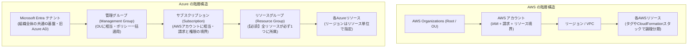
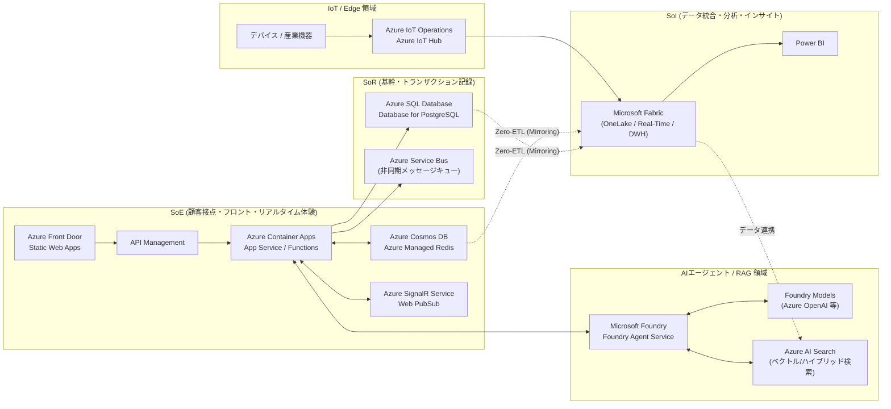

# AWS経験者のための Microsoft Azure サービスガイド

本ドキュメント群は、**AWS（Amazon Web Services）での設計・開発経験を持つエンジニア**が、**Microsoft Azure** の全体像と各サービスの特性を把握するための学習資料です。

Webアプリケーション開発を主軸に、**SoR（Systems of Record）/ SoE（Systems of Engagement）/ SoI（Systems of Insight）** の各アーキテクチャ領域、ならびに **AIエージェント開発** や **IoT・エッジ開発** まで、Microsoft Learn の公式情報に基づき AWS サービスとの対比で整理しています。

---

## 📚 ドキュメント構成（目次）

1. **[全体概要・基本概念の対比・早見表（本ページ）](./index.md)**
   - AWSとAzureのアカウント/リソース階層の構造的な違い
   - SoR / SoE / SoI × クラウドサービスのアーキテクチャマッピング
   - 全カテゴリ横断・AWS ⇔ Azure 主要サービス早見表（チートシート）
2. **[Webアプリ開発基盤（コンピュート・ネットワーク・配信）](./web-app-compute-network.md)**
   - 仮想マシン、PaaS（App Service / Static Web Apps）、コンテナ（ACA / AKS）、サーバーレス（Functions）
   - ネットワーク（VNet）、負荷分散（Front Door / App Gateway / Load Balancer）、API管理
3. **[データ基盤と SoR / SoE / SoI アーキテクチャ（DB・ストレージ・統合・分析）](./data-sor-soe-soi.md)**
   - RDB（Azure SQL / PostgreSQL）、NoSQL（Cosmos DB）、キャッシュ、ストレージ（Blob / Azure Files）
   - イベント駆動・メッセージング（Service Bus / Event Grid / Event Hubs）
   - 統合データ分析基盤（Microsoft Fabric / Synapse / Purview）
4. **[AIエージェント・生成AI・機械学習開発](./ai-agent.md)**
   - Microsoft Foundry（旧 Azure AI Foundry）、Foundry Agent Service、Foundry Tools（旧 Azure AI Services）
   - RAG構築（Azure AI Search / Cosmos DB Vector Search）
   - エージェントフレームワーク（Semantic Kernel / AutoGen）、ガードレール、PTU スピルオーバー、MLOps
5. **[IoT・エッジコンピューティング開発](./iot-edge.md)**
   - クラウドIoT基盤（Azure IoT Hub / DPS）とエッジ統合基盤（Azure IoT Operations / Azure Arc）
   - 産業プロトコル対応（MQTT / OPC UA）、オフライン動作制限（最大72時間）、Azure Digital Twins、Fabric連携
6. **[認証・セキュリティ・監視・DevOps・ガバナンス](./security-devops-governance.md)**
   - ID/アクセス管理（Microsoft Entra ID / Entra External ID / Managed Identity / RBAC）
   - セキュリティ（Defender / Sentinel / Key Vault）、監視（Azure Monitor / Application Insights）、IaC（Bicep / Terraform）
7. **[Azure Bicep 学習資料](./bicep/index.md)**
   - 導入・インストール、基本構文、ビルド・検証、デプロイ方法（What-If / デプロイ スタック）、GitHub Actions 連携、注意事項
8. **[Static Web Apps を使った開発標準プロセス](./static-web-apps/index.md)**
   - アーキテクチャ、ローカル開発、CI/CD、Bicep による環境構築、運用 Tips

---

## 1. 最初に押さえるべき「AWSとAzureの構造的な違い」

個別のサービスを比較する前に、**アカウント構造・リソース管理・ID管理の設計思想の違い**を理解しておくと、Azureの設計が把握しやすくなります。
（参考：[AWS プロフェッショナル向けの Azure (Microsoft Learn)](https://learn.microsoft.com/azure/architecture/aws-professional/)）

### 1-1. アカウントとリソース階層の対比

AWSでは「AWSアカウント」がリソース分離と請求の最小単位ですが、Azureでは **Microsoft Entra テナント（IDの境界）** の下に複数の **サブスクリプション（請求・クォータ・ガバナンスの境界）** を持ち、さらにその中に **リソースグループ（ライフサイクル管理の必須コンテナ）** を作成します。

| 概念 | AWS | Azure | AWS経験者が注意すべきポイント |
| :--- | :--- | :--- | :--- |
| **IDのルート境界** | IAM（各AWSアカウント内） / IAM Identity Center | **Microsoft Entra テナント**（旧 Azure AD） | Azureでは最初にテナント（組織の共通ディレクトリ）が存在し、Microsoft 365等と同じID基盤の上でサブスクリプションを管理する。 |
| **階層グループ化** | AWS Organizations (OU) | **管理グループ (Management Groups)** | 複数のサブスクリプションをツリー状に束ね、Azure PolicyやRBACを一括適用する。 |
| **アカウント境界** | AWS アカウント | **サブスクリプション (Subscription)** | AWSのマルチアカウント戦略は、Azureでは**「マルチサブスクリプション戦略（Azure Landing Zones）」**に相当する。 |
| **リソースの論理箱** | 任意（タグやResource Groups） | **リソースグループ (Resource Group)** | **Azureのすべてのリソースは必ず1つのリソースグループに所属する。** 削除時はリソースグループごと一括削除できるため、環境別・システム別のライフサイクル管理に適している。 |
| **リージョン概念** | コンソール画面でリージョンを切り替えて操作 | **グローバルビューが基本**（リソース作成時にLocationを指定） | Azure Portalの一覧画面では、原則として全リージョンのリソースが横断表示され、フィルターで絞り込む方式をとる。 |

### 1-2. IAMロールと認証の考え方の違い

* **AWSの「IAM Role（AssumeRole）」 ≒ Azureの「マネージドID (Managed Identity)」**
  * AWSでEC2やECSタスク、Lambdaに付与するIAMロールは、Azureでは **[マネージドID（システム割り当て / ユーザー割り当て）](https://learn.microsoft.com/entra/identity/managed-identities-azure-resources/overview)** と呼ばれます。
  * アプリケーションコードからは `DefaultAzureCredential`（Azure Identity SDK）を使うことで、ローカル開発時は開発者のCLI資格情報、クラウド上ではマネージドIDを自動的に切り替えて認証できます。
* **IAMポリシー ≒ Azure RBAC（ロールベースのアクセス制御）**
  * Azureでは、**[Azure RBAC](https://learn.microsoft.com/azure/role-based-access-control/overview)** の組み込みロール（閲覧者、共同作成者、所有者、Key Vault シークレット ユーザーなど）を「スコープ（管理グループ / サブスクリプション / リソースグループ / 個別リソース）」に対して割り当てる運用が基本です。

---

## 2. アーキテクチャ領域別（SoR / SoE / SoI / AI / IoT）の全体像

エンタープライズWebシステムで求められる **SoR・SoE・SoI**、および **AIエージェント・IoT** がAzure上でどのように構成されるかの全体マップです。

### 各領域におけるAzure選定の代表パターン

| アーキテクチャ分類 | 目的・特性 | AWSでの代表構成例 | Azureでの代表構成例 |
| :--- | :--- | :--- | :--- |
| **SoR** *(Systems of Record)* | 正確性・一貫性・信頼性が重視される基幹業務・勘定系データ記録 | ALB + ECS + RDS (Aurora) + SQS | **Application Gateway** + **App Service / AKS** + **Azure SQL Database** (または PostgreSQL) + **Azure Service Bus** |
| **SoE** *(Systems of Engagement)* | 顧客体験・俊敏性・スケーラビリティ・イベント駆動が求められるWeb/モバイル層 | CloudFront + API Gateway + ECS Fargate / Lambda + DynamoDB + ElastiCache | **Azure Front Door** + **API Management** + **Azure Container Apps (ACA) / Functions** + **Azure Cosmos DB** + **Azure Managed Redis** |
| **SoI** *(Systems of Insight)* | 蓄積されたデータからビジネスインサイトやAI活用データを導き出す分析層 | S3 + Glue + Redshift / Athena + QuickSight | **Microsoft Fabric** (OneLake + Data Factory + Synapse DWH + Real-Time Intelligence + **Power BI**) + **Microsoft Purview** |
| **AI Agent** *(Systems of Intelligence)* | 自律的な推論・ツール実行・社内知識検索（RAG）を行うエージェント層 | Amazon Bedrock + Bedrock Agents + Knowledge Bases (OpenSearch) | **Microsoft Foundry** + **Foundry Agent Service** + **Semantic Kernel** + **Foundry Models (Azure OpenAI)** + **Azure AI Search** |
| **IoT / Edge** *(Physical & OT Integration)* | 現場機器の双方向通信、エッジ処理、デジタルツイン、IT/OT統合 | AWS IoT Core + IoT Greengrass + IoT TwinMaker + Kinesis | **Azure IoT Hub** + **Azure IoT Operations (Arc)** + **Azure Digital Twins** + **Event Hubs / Fabric RTI** |

---

## 3. AWS ⇔ Azure 主要サービス横断チートシート

実務でよく登場するサービスのクイックリファレンスです。各サービスの提供条件・プレビュー制限・公式リンクは各分野別ページで解説しています。
（公式比較一覧：[AWS と Azure のサービスの比較 - Microsoft Learn](https://learn.microsoft.com/azure/architecture/aws-professional/services)）

### コンピュート & Webアプリ実行環境
👉 詳細は [Webアプリ開発基盤](./web-app-compute-network.md) へ

| 用途 | AWS | Azure | 概要と注意点 |
| :--- | :--- | :--- | :--- |
| 仮想サーバー (IaaS) | Amazon EC2 | **Azure Virtual Machines (VM)** | 基本概念は共通。自動スケールは **VM Scale Sets (VMSS)**。 |
| フルマネージドWebアプリ (PaaS) | Elastic Beanstalk / App Runner | **Azure App Service (Web Apps)** | コードまたはコンテナをデプロイして動かすWebアプリ向けPaaS。認証機能やデプロイスロットを標準搭載。 |
| サーバーレスコンテナ | Amazon ECS (AWS Fargate) | **Azure Container Apps (ACA)** | Kubernetes (Knative/KEDA/Dapr) ベースでクラスタ管理が不要なコンテナ実行環境。 |
| マネージドKubernetes | Amazon EKS | **Azure Kubernetes Service (AKS)** | 無料ティア（SLAなし）とStandard/Premiumティア（稼働時間SLA付き）を選択可能。 |
| 単発コンテナ起動 | AWS Fargate (RunTask) | **Azure Container Instances (ACI)** | オーケストレーターなしで単発コンテナを起動（定期・並列バッチにはACA Jobsも利用可能）。 |
| サーバーレス関数 (FaaS) | AWS Lambda | **Azure Functions** | トリガー/バインディングによる宣言的連携が特徴。**Durable Functions**でコードベースの状態管理が可能。 |
| フロントエンド配信 | AWS Amplify Hosting / S3+CF | **Azure Static Web Apps (SWA)** | SPAホスティングとAPI統合を提供。※Next.jsハイブリッドレンダリング対応は**プレビュー**であり、リンク済みAPI等の制限あり。 |

### ネットワーク・CDN・API
👉 詳細は [Webアプリ開発基盤](./web-app-compute-network.md) へ

| 用途 | AWS | Azure | 概要と注意点 |
| :--- | :--- | :--- | :--- |
| 仮想ネットワーク | Amazon VPC | **Azure Virtual Network (VNet)** | サブネット単位でルートテーブルやNSGを紐付ける。 |
| グローバルCDN + WAF + GSLB | Amazon CloudFront + Route 53 + WAF | **Azure Front Door** | CDN・グローバルL7負荷分散・WAFを統合したエッジ配信サービス。 |
| リージョン内L7ロードバランサー | Application Load Balancer (ALB) | **Azure Application Gateway** | VNet内のL7ルーティング・SSL終端・WAFを提供。 |
| L4ロードバランサー | Network Load Balancer (NLB) | **Azure Load Balancer** | TCP/UDPのL4負荷分散。 |
| APIゲートウェイ | Amazon API Gateway | **Azure API Management (APIM)** | API管理に加え、AI向けの**GenAI Gateway（トークン制限・セマンティックキャッシュ・負荷分散）**機能を提供。 |
| プライベート接続 | AWS PrivateLink | **Azure Private Link / Private Endpoint** | PaaS（Storage, SQL, Foundry Models等）にVNet内のプライベートIPを付与して閉域網接続する。 |

### データベース・ストレージ・メッセージング・分析
👉 詳細は [データ基盤と SoR / SoE / SoI アーキテクチャ](./data-sor-soe-soi.md) へ

| 用途 | AWS | Azure | 概要と注意点 |
| :--- | :--- | :--- | :--- |
| マネージドRDB | Amazon RDS / Aurora | **Azure SQL Database** / **SQL Managed Instance** / **Database for PostgreSQL・MySQL** | **SQL Hyperscale**は単一DB最大**128 TB**まで対応。**SQL MI**はオンプレミスSQL Serverと高い互換性を持つが、T-SQLや機能の差異があるため事前評価が必要。 |
| 分散NoSQLデータベース | Amazon DynamoDB | **Azure Cosmos DB** | アカウント作成時にAPI（NoSQL, MongoDB, Cassandra, Gremlin, Table等）を選択する（同一アカウント内での混在は不可）。99.999%可用性SLAや1桁ミリ秒遅延SLAにはマルチリージョン書き込み等の適用条件がある。 |
| インメモリキャッシュ | Amazon ElastiCache | **Azure Managed Redis** (および Cache for Redis) | Redis Enterprise技術を採用したフルマネージドキャッシュ。 |
| オブジェクトストレージ | Amazon S3 | **Azure Blob Storage** | ストレージアカウント内に作成。階層型名前空間ONで **Data Lake Storage Gen2** になる。 |
| ファイル共有ストレージ | Amazon EFS / FSx for Windows | **Azure Files** | SMBまたはNFSv4.1をサポート。※同一ファイル共有でのSMB/NFS併用は不可。NFSはPremiumティア必須などプロトコルごとに要件が異なる。 |
| メッセージキュー (SoR連携) | Amazon SQS | **Azure Service Bus** | トランザクション・セッション（順序保証）・デッドレターなどを備えたメッセージブローカー。 |
| イベントルーター | Amazon EventBridge | **Azure Event Grid** | リソースの状態変更やカスタムイベントをPush型で配信（MQTTブローカー機能も提供）。 |
| ストリーミング取り込み | Amazon Kinesis Data Streams | **Azure Event Hubs** | 大量イベントを受け止めるデータストリームの入口（Kafka互換エンドポイントあり）。 |
| ワークフロー制御 | AWS Step Functions | **Azure Logic Apps** / **Durable Functions** | GUIベースの「Logic Apps（多数のSaaSコネクタ搭載）」と、コードベースの「Durable Functions」。 |
| 統合データ分析 (SoI) | Glue + EMR + Redshift + QuickSight | **Microsoft Fabric** | データレイク(OneLake)、ETL、Spark、DWH、リアルタイム分析、Power BIを統合した分析SaaS。 |

### AIエージェント・生成AI・IoT
👉 詳細は [AIエージェント・生成AI開発](./ai-agent.md) および [IoT・エッジ開発](./iot-edge.md) へ

| 用途 | AWS | Azure | 概要と注意点 |
| :--- | :--- | :--- | :--- |
| 生成AI統合開発ハブ | Amazon Bedrock | **Microsoft Foundry** (旧 Azure AI Foundry / AI Studio) | OpenAIモデルやOSSモデルのカタログ、評価、安全フィルタ、エージェント開発を統合。 |
| マネージドAIエージェント | Amazon Bedrock Agents | **Foundry Agent Service** (旧 Azure AI Agent Service) | 新版（GA）は **Responses API / Conversations API** ベース。旧 Assistants API ベースの **Agents (classic) は非推奨（2027年3月31日廃止予定）**。 |
| 特化型AI API群 | Rekognition / Polly / Textract 等 | **Foundry Tools** (旧 Azure AI Services / Cognitive Services) | 音声（Speech）、画像（Vision）、言語（Language）、翻訳（Translator）、文書解析（Document Intelligence）等のAPI群。 |
| RAG・検索エンジン | OpenSearch Service / Bedrock KB | **Azure AI Search** | ハイブリッド検索（ベクトル＋全文）とセマンティックランカーはGA。LLMでクエリ分解を行う **Agentic Retrieval はプレビュー機能**。 |
| IoTクラウドゲートウェイ | AWS IoT Core | **Azure IoT Hub** | デバイス双方向通信、Device Twin管理。 |
| エッジ・OT統合基盤 | AWS IoT Greengrass / SiteWise | **Azure IoT Operations** | Azure Arc対応K8s上で動作する産業エッジ基盤（MQTT、OPC UA、Fabric連携）。※オフライン動作のキャッシュ保持は**最大72時間**の制限あり。 |

### セキュリティ・監視・DevOps
👉 詳細は [認証・セキュリティ・監視・DevOps・ガバナンス](./security-devops-governance.md) へ

| 用途 | AWS | Azure | 概要と注意点 |
| :--- | :--- | :--- | :--- |
| 社内ID管理・認証 (IdP) | AWS IAM / IAM Identity Center | **Microsoft Entra ID** | 従業員向けの統合ID基盤。 |
| 顧客向け認証 (CIAM) | Amazon Cognito | **Microsoft Entra External ID** | 次世代CIAM製品（※Azure AD B2Cの単なる改称ではなく新アーキテクチャ。**Azure AD B2Cは2025年5月1日以降、新規顧客向け販売を終了**）。 |
| シークレット・鍵管理 | Secrets Manager / KMS | **Azure Key Vault** | 暗号鍵管理、シークレット管理、証明書管理を統合。 |
| 統合監視・APM | CloudWatch + X-Ray | **Azure Monitor** + **Application Insights** | インフラ監視のMonitor（Log Analytics）と、OpenTelemetryベースのAPMであるApplication Insights。 |
| IaC (コード化インフラ) | AWS CloudFormation / CDK | **Azure Bicep** / Terraform | Azureリソース定義に特化した宣言型DSL「Bicep」またはTerraformを利用。 |
| ガバナンス・統制 | AWS Organizations SCP + Config | **Azure Policy** | リソース作成時の事前拒否（Deny）や事後監査・自動修復（Modify/DeployIfNotExists）を定義。 |
