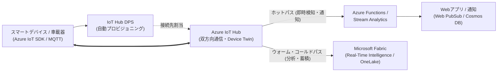
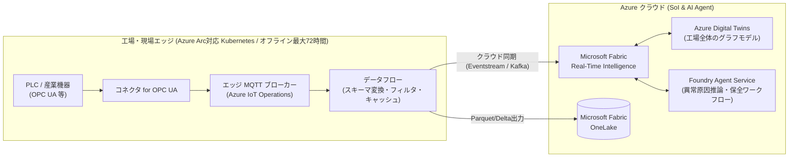

# IoT・エッジコンピューティング・デジタルツイン開発

製造業（スマートファクトリー）、モビリティ、スマートビルディング、エネルギー管理などのIoT分野における Microsoft Azure のサービス群を、Microsoft Learn の公式情報に基づき AWS と比較しながら解説します。
（参考：[AWS プロフェッショナル向けの IoT サービス - Microsoft Learn](https://learn.microsoft.com/azure/architecture/aws-professional/iot)）

近年では、クラウド直結型IoT（**[Azure IoT Hub](https://learn.microsoft.com/azure/iot-hub/iot-concepts-and-iot-hub)**）に加え、工場や現場のKubernetesエッジ環境とクラウド（**Microsoft Fabric**）を統合する **[Azure IoT Operations](https://learn.microsoft.com/azure/iot-operations/overview-iot-operations)** が産業IoT向けの主要アーキテクチャとして提供されています。

---

## 1. IoT・エッジ関連サービスの全体像とAWS比較

| カテゴリ | AWS サービス | Azure サービス | 特徴・提供条件とAWS経験者向け解説 |
| :--- | :--- | :--- | :--- |
| **IoTクラウドゲートウェイ** | AWS IoT Core | **[Azure IoT Hub](https://learn.microsoft.com/azure/iot-hub/iot-concepts-and-iot-hub)** | IoTデバイスとクラウド間で双方向通信（MQTT, AMQP, HTTPS）を提供するマネージドハブ。デバイスの状態同期を行う **[Device Twin](https://learn.microsoft.com/azure/iot-hub/iot-hub-devguide-device-twins)**（AWSのDevice Shadow相当）や、クラウドからのダイレクトメソッド呼び出し機能を持つ。 |
| **ゼロタッチ・プロビジョニング** | AWS IoT Core (Fleet Provisioning) | **[Azure IoT Hub Device Provisioning Service (DPS)](https://learn.microsoft.com/azure/iot-dps/about-iot-dps)** | デバイスが初回起動時に、X.509証明書やTPM等を基に「どのリージョンのどのIoT Hubに接続すべきか」を自動判別・登録するプロビジョニングサービス。 |
| **クラウドMQTTブローカー** | AWS IoT Core (MQTT) | **[Azure Event Grid (MQTT ブローカー機能)](https://learn.microsoft.com/azure/event-grid/mqtt-overview)** | Event Grid Namespace SKUで提供されるMQTT v3.1.1 / v5対応ブローカー。IoT HubのDevice Twin管理ではなく、柔軟なトピック空間によるPub/Sub通信（モビリティやテレメトリ配信等）を行いたい場合に適している。 |
| **産業エッジ・OT統合基盤** | AWS IoT Greengrass + AWS IoT SiteWise Edge | **[Azure IoT Operations](https://learn.microsoft.com/azure/iot-operations/overview-iot-operations)** (enabled by Azure Arc) | 現場のエッジ環境（Azure Arc対応Kubernetesクラスター）上にデプロイするモジュール型データプレーン。産業用プロトコル（**OPC UA**等）の取り込み、エッジネイティブなMQTTブローカー、データフロー変換、および **Microsoft Fabric (OneLake / Real-Time Intelligence)** や Event Hubs へのクラウド同期を提供する。 ⚠️ **オフライン動作制限**：ネットワーク切断時のオフライン継続動作は**最大72時間**まで（詳細は「2-2. パターンB」の注意点を参照）。 |
| **単一デバイス向けエッジランタイム** | AWS IoT Greengrass | **[Azure IoT Edge](https://learn.microsoft.com/azure/iot-edge/about-iot-edge)** | Linux（またはWindows上のLinuxコンテナ / EFLOW）デバイス上でDocker互換コンテナとしてクラウドモジュールを動かすランタイム。IoT Hubと対になって動作する。 |
| **ハイブリッド・エッジ管理基盤** | AWS Systems Manager (Hybrid) / EKS Anywhere | **[Azure Arc](https://learn.microsoft.com/azure/azure-arc/overview)** | オンプレミスサーバー、エッジKubernetesクラスター（AKS Edge Essentials、K3s、Ubuntu上のCanonical Kubernetes等）、他社クラウドのリソースを、Azure Resource Manager（ARM）の制御下に統合し、Azure Portal・Azure Policy・GitOpsで管理する基盤。 |
| **デジタルツイン基盤** | AWS IoT TwinMaker | **[Azure Digital Twins (ADT)](https://learn.microsoft.com/azure/digital-twins/overview)** | 建物、工場ライン、電力網などの「人・場所・機器の関係性」をモデリング言語 **[DTDL (Digital Twins Definition Language)](https://learn.microsoft.com/azure/digital-twins/concepts-models)** で空間グラフとして定義・クエリするPaaS。3D可視化ツール（3D Scenes Studio）も備える。 |
| **組込みRTOS・マイコン保護** | FreeRTOS | **[Eclipse ThreadX (旧 Azure RTOS)](https://learn.microsoft.com/azure/iot/iot-overview)** / **[Azure Sphere](https://learn.microsoft.com/azure/sphere/product-overview/what-is-azure-sphere)** | 組込みマイコン向けリアルタイムOS（現在はEclipse Foundationへ寄贈されオープンソース化）および、認定チップ・カスタムLinux OS・クラウドセキュリティサービスを組み合わせた **Azure Sphere**。 |
| **位置情報・地図・空間サービス** | Amazon Location Service | **[Azure Maps](https://learn.microsoft.com/azure/azure-maps/about-azure-maps)** | 地図レンダリング、ジオコーディング、ルート検索、ジオフェンス、気象データなどをWebアプリに組み込む位置情報サービス。 |

---

## 2. 2つの代表的なIoTアーキテクチャパターン

開発するIoTシステムの性質（「広域インターネットに直接繋がるコネクテッド機器」か、「工場やプラントの閉域OTネットワーク」か）によって、選定すべきアーキテクチャが異なります。

### 2-1. パターンA：コネクテッド製品・広域デバイス向け（クラウド直結型）
スマート家電、建機・モビリティ、業務用端末など、個々のデバイスがセルラー回線やWi-Fi経由で直接クラウドと通信するパターンです（AWSのIoT Core中心の構成に近いモデルです）。

### 2-2. パターンB：スマートファクトリー・産業OT統合向け（Azure IoT Operations）
工場内のPLCやセンサーなど、インターネットに直接接続しない産業機器をエッジクラスターで束ね、エッジ側で一次処理を行いつつクラウドの分析・AI基盤と統合するパターンです。

> [!WARNING]
> **Azure IoT Operations の提供条件とオフライン動作の制限（最大72時間）**
> （参考：[Azure IoT Operations の概要 - Microsoft Learn](https://learn.microsoft.com/azure/iot-operations/overview-iot-operations)）
> * **オフライン動作（最大72時間）の制限**：Azure IoT Operations はインターネット接続が一時的に切断された環境でもエッジ側のMQTTブローカー（ディスクバックドバッファ）やローカルワークロードによって運用を継続できますが、**サポートされるオフライン（切断）期間は最大72時間**です。常時完全オフライン（エアギャップ）環境での無期限運用はサポート対象外であり、定期的なAzureクラウド（Azure Arcコントロールプレーン）との通信が必要です。
> * **実行環境の前提条件**：デプロイ先として **Azure Arc 対応 Kubernetes クラスター**（CNCF認定K8s、AKS Edge Essentials、Ubuntu上のK3s等）および永続ボリューム用ストレージクラス、Azure Container Storage（エッジボリューム）等の要件を満たす必要があります。

---

## 3. AWS経験者が押さえるべき「Azure IoT」の主要コンセプト

1. **[Device Twin（デバイスツイン）](https://learn.microsoft.com/azure/iot-hub/iot-hub-devguide-device-twins) による状態同期**
   * AWS IoT Coreの「Device Shadow」に相当します。
   * クラウド側のWebアプリが「設定温度を22度に変更する」といった **Desired Properties（希望プロパティ）** をJSONで書き込むと、デバイスへ通知され、デバイス側が変更処理を完了すると **Reported Properties（報告プロパティ）** を書き戻すことで状態を同期します。
2. **[DTDL（Digital Twins Definition Language）](https://learn.microsoft.com/azure/digital-twins/concepts-models) によるモデル定義**
   * デバイスや空間アセットの能力（テレメトリ、プロパティ、コマンド、コンポーネント、関係性）を記述するJSON-LDベースのモデリング言語です。IoTデバイス定義から Azure Digital Twins の空間グラフ構築まで共通フォーマットで管理できます。
3. **IoTデータと Foundry Agent Service / Microsoft Fabric の連携**
   * Azure IoT Operations のデータフローや Azure IoT Hub から Microsoft Fabric（Eventhouse / OneLake）へ稼働データを集約することで、**[Foundry Agent Service](./ai-agent.md)** のエージェントから工場の稼働状況の照会や、保全マニュアル（Azure AI Search）と照合した点検チケット発行（Logic Apps / Service Bus連携）などのワークフローを構成できます。
