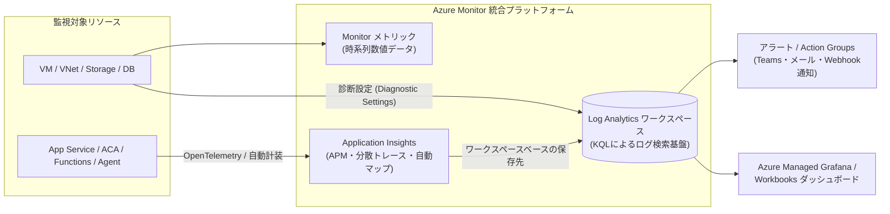

# 認証・セキュリティ・監視・DevOps・ガバナンス

WebアプリケーションやAIエージェントの本番運用に不可欠な認証・認可、シークレット管理、可観測性（Observability）、CI/CD、およびマルチサブスクリプション統制（ガバナンス）について、Microsoft Learn の公式情報に基づき AWS の各サービスと対比しながら解説します。
（参考：[AWS プロフェッショナル向けのセキュリティと ID - Microsoft Learn](https://learn.microsoft.com/azure/architecture/aws-professional/security-identity)）

---

## 1. ID管理・認証・認可（IAM / Cognito との比較）

AWSでは「AWSリソースを操作する権限（AWS IAM）」「SSO管理（IAM Identity Center）」「Webアプリの顧客ログイン基盤（Amazon Cognito）」が別々のサービスとして分かれていますが、Azureでは **Microsoft Entra ファミリー** と **Azure RBAC** の組み合わせで管理します。

| 用途 | AWS サービス | Azure サービス | 特徴・提供条件とAWS経験者向け解説 |
| :--- | :--- | :--- | :--- |
| **社内ID管理・SSO (IdP)** | AWS IAM Identity Center / IAM Users | **[Microsoft Entra ID](https://learn.microsoft.com/entra/fundamentals/whatis)** (旧称 Azure Active Directory) | 企業の従業員ID、Microsoft 365、Azure管理ポータル、社内向けWebアプリ（SoR）のOIDC/SAML認証を統合管理するクラウドIdP。条件付きアクセス（Conditional Access：P1/P2ライセンス要件あり）によるアクセス制御機能を備える。 |
| **顧客向け認証基盤 (CIAM)** | Amazon Cognito (User Pools) | **[Microsoft Entra External ID](https://learn.microsoft.com/entra/external-id/customers/overview-customers-ciam)** | コンシューマー向けWebアプリ（SoE）やB2B取引先向けのログイン基盤を提供する**次世代CIAM製品**。 ⚠️ **重要**：**Azure AD B2C の単なる改称ではなく、Microsoft Entra 基盤上に新設計された別製品**である。なお、旧来の **[Azure AD B2C は2025年5月1日をもって新規顧客向けの販売（新規購入）が終了](https://learn.microsoft.com/azure/active-directory-b2c/faq)** しており、新規のCIAM構築では Microsoft Entra External ID を採用する（詳細は「1-1. Entra External ID と Azure AD B2C の関係」を参照）。 |
| **リソース間の権限付与** | IAM Role (EC2/ECS/Lambda Role) | **[マネージド ID (Managed Identity)](https://learn.microsoft.com/entra/identity/managed-identities-azure-resources/overview)** | App ServiceやACA、VM等に対してEntra ID上のIDを自動発行し、コード内に資格情報（シークレット）を持たせずに他のAzureリソースへアクセスさせる仕組み。リソースとライフサイクルを共にする **システム割り当て (System-assigned)** と、独立して複数リソースで共有できる **ユーザー割り当て (User-assigned)** の2種類がある。 |
| **クラウド操作の認可制御** | AWS IAM Policy | **[Azure RBAC (ロールベースのアクセス制御)](https://learn.microsoft.com/azure/role-based-access-control/overview)** | 「セキュリティプリンシパル（Entra IDのユーザー/グループ/サービスプリンシパル/マネージドID）」「ロール定義（Owner, Contributor, Reader、またはデータプレーン用ロール）」「スコープ（管理グループ / サブスクリプション / リソースグループ / 個別リソース）」の3要素でアクセス権を割り当てる。 |

### 1-1. Microsoft Entra External ID と Azure AD B2C の関係・移行方針

顧客向けID管理（CIAM）を検討する際、以前の資料や書籍で登場する「Azure AD B2C」と現行の「Microsoft Entra External ID」の違いに注意が必要です。
（参考：[外部テナントの Microsoft Entra External ID の概要 - Microsoft Learn](https://learn.microsoft.com/entra/external-id/customers/overview-customers-ciam)、[Azure Active Directory B2C に関する FAQ - Microsoft Learn](https://learn.microsoft.com/azure/active-directory-b2c/faq)）

* **別アーキテクチャの次世代CIAM製品**：Microsoft Entra External ID は Azure AD B2C の名称変更（リブランディング）ではなく、Microsoft Entra の最新プラットフォーム上に統合・刷新された次世代のCIAMソリューションです（社内テナントへのB2Bゲスト招待と、顧客向けに分離された「外部テナント（External tenant）」構成の両方をサポートします）。
* **Azure AD B2C の新規販売終了（2025年5月1日〜）**：**2025年5月1日以降、新規の顧客（該当時点で既存のAzure AD B2Cテナントを保有していない組織）は Azure AD B2C を新規購入・テナント作成できなくなっています**。
* **既存B2Cユーザーの扱いと新規構築の方針**：既存の Azure AD B2C 利用顧客は引き続きテナントの運用が可能であり、少なくとも **2030年5月まで** サポートが継続されますが、**これから新規に構築するコンシューマー向けWebアプリの認証基盤には Microsoft Entra External ID を選択する必要があります**（なお、B2C特有のXMLベース「カスタムポリシー（Identity Experience Framework）」は Entra External ID では採用されておらず、ネイティブ認証APIやカスタム認証拡張機能（Custom authentication extensions）を用いる設計となります）。

---

## 2. セキュリティ・シークレット・構成管理

| カテゴリ | AWS サービス | Azure サービス | 特徴・提供条件とAWS経験者向け解説 |
| :--- | :--- | :--- | :--- |
| **鍵・シークレット・証明書管理** | AWS KMS + AWS Secrets Manager + ACM (一部) | **[Azure Key Vault](https://learn.microsoft.com/azure/key-vault/general/overview)** | ①暗号化キー管理（KMS相当）、②DBパスワードやAPIキー等のシークレット管理（Secrets Manager相当）、③SSL/TLS証明書の保管・更新管理を統合したサービス（StandardティアとFIPS 140-2/140-3 Level 3 HSM backedのPremiumティア / Managed HSMがある）。 |
| **アプリ構成・機能フラグ管理** | AWS AppConfig + SSM Parameter Store | **[Azure App Configuration](https://learn.microsoft.com/azure/azure-app-configuration/overview)** | 複数環境・マイクロサービス間で共有する環境設定値や、**Feature Flags（機能フラグ：再デプロイなしでの新機能ON/OFF切り替え）** を一元管理するサービス。機密情報は Key Vault 参照としてリンクさせる構成が推奨される。 |
| **DDoS防御** | AWS Shield (Standard / Advanced) | **[Azure DDoS Protection](https://learn.microsoft.com/azure/ddos-protection/ddos-protection-overview)** | インフラ標準の保護に加え、VNet単位で保護と攻撃分析・コスト保護を適用する **DDoS Network Protection** と、単一パブリックIP単位で適用できる **DDoS IP Protection** の2つの有償SKUがある。 |
| **CSPM / CWPP (クラウドセキュリティ姿勢管理)** | AWS Security Hub + Amazon GuardDuty + Amazon Inspector | **[Microsoft Defender for Cloud](https://learn.microsoft.com/azure/defender-for-cloud/defender-for-cloud-introduction)** | マルチクラウド（Azure / AWS / GCP）対応のセキュリティ管理基盤。無料の基本的CSPM（セキュアスコア評価）と、有償のDefenderプラン（サーバー、コンテナ、SQL、Storage、Key Vault、AIワークロード等の脅威保護CWPP）で構成される。 |
| **クラウドネイティブ SIEM / SOAR** | Amazon Security Lake + SIEM | **[Microsoft Sentinel](https://learn.microsoft.com/azure/sentinel/overview)** | クラウド・オンプレミス・Microsoft 365等のセキュリティログを Log Analytics ワークスペース上に集約し、相関分析・インシデント検知と、Logic Apps ベースの Playbook による自動対応（SOAR）を行うSIEM。 |

---

## 3. 監視・ロギング・可観測性（Observability）

（参考：[Azure Monitor の概要 - Microsoft Learn](https://learn.microsoft.com/azure/azure-monitor/overview)）

AWSでは CloudWatch（Metrics / Logs / Alarms）と AWS X-Ray に分かれていますが、Azureでは **[Azure Monitor](https://learn.microsoft.com/azure/azure-monitor/overview)** の傘下に、ログ分析基盤（Log Analytics）とAPM（Application Insights）が統合されています。

| カテゴリ | AWS サービス | Azure サービス | 特徴・提供条件とAWS経験者向け解説 |
| :--- | :--- | :--- | :--- |
| **統合監視基盤** | Amazon CloudWatch | **[Azure Monitor](https://learn.microsoft.com/azure/azure-monitor/overview)** | メトリック収集、ログ収集、アラート発報、オートスケールトリガーを統括する基盤。**※各PaaSのリソースログを保存するには、リソースごとに「[診断設定 (Diagnostic Settings)](https://learn.microsoft.com/azure/azure-monitor/essentials/diagnostic-settings)」を構成して送信先（Log Analytics等）を指定する必要がある。** |
| **ログ集約・検索エンジン** | CloudWatch Logs + Logs Insights | **[Azure Monitor Logs (Log Analytics ワークスペース)](https://learn.microsoft.com/azure/azure-monitor/logs/data-platform-logs)** | ログデータを集約するワークスペース。検索・集計には **[KQL (Kusto Query Language)](https://learn.microsoft.com/kusto/query/)** を使用する。データの取り込み量と保持期間に応じた課金体系（Analytics ログプラン、Basic ログプラン、Auxiliary ログプラン）を選択可能。 |
| **APM・分散トレーシング** | AWS X-Ray + CloudWatch Application Signals | **[Application Insights](https://learn.microsoft.com/azure/azure-monitor/app/app-insights-overview)** | OpenTelemetry準拠のAPM機能。エージェントによる自動計装（Auto-instrumentation）または Azure Monitor OpenTelemetry Distro SDK の導入により、Webアプリ→API→SQL→Cosmos DB→外部APIの依存関係とレスポンス時間・失敗率をトポロジー図（**アプリケーションマップ**）として可視化する。 |
| **監査ログ (コントロールプレーン操作)** | AWS CloudTrail | **[Azure アクティビティ ログ (Activity Log)](https://learn.microsoft.com/azure/azure-monitor/essentials/activity-log)** | サブスクリプション内で「誰がいつどのリソースを作成・変更・削除したか」を記録するコントロールプレーン監査ログ。デフォルトで90日間保持され、長期保存やクエリ分析には診断設定で Log Analytics や Storage へエクスポートする。 |
| **クラウド障害通知** | AWS Health Dashboard | **[Azure Service Health](https://learn.microsoft.com/azure/service-health/overview)** | Azureのサービス障害情報、計画メンテナンス通知、および特定リソースの正常性（Resource Health）を通知するサービス。 |

---

## 4. DevOps・CI/CD・IaC（Infrastructure as Code）

| カテゴリ | AWS サービス | Azure サービス | 特徴・提供条件とAWS経験者向け解説 |
| :--- | :--- | :--- | :--- |
| **CI/CD・プロジェクト管理** | AWS CodePipeline / CodeBuild | **[GitHub Actions](https://learn.microsoft.com/azure/developer/github/github-actions)** / **[Azure DevOps](https://learn.microsoft.com/azure/devops/user-guide/what-is-azure-devops)** | ソース管理・CI/CDの **GitHub** と、要件管理（Azure Boards）・リポジトリ（Repos）・CI/CD（Pipelines）・テスト計画（Test Plans）・パッケージ管理（Artifacts）を統合した **Azure DevOps** が提供されている。いずれも Workload Identity Federation（OIDC）によるシークレットレスなAzureデプロイに対応。 |
| **コンテナレジストリ** | Amazon ECR | **[Azure Container Registry (ACR)](https://learn.microsoft.com/azure/container-registry/container-registry-intro)** | DockerイメージやHelmチャート、OCIアーティファクトを保管するプライベートレジストリ（Basic / Standard / Premium SKUがあり、Private Link対応やgeoレプリケーションはPremiumで提供）。 |
| **IaC (コード化インフラ)** | AWS CloudFormation / AWS CDK | **[Azure Bicep](https://learn.microsoft.com/azure/azure-resource-manager/bicep/overview)** / **[ARM Templates](https://learn.microsoft.com/azure/azure-resource-manager/templates/overview)** / **Terraform** | ARMテンプレート（JSON）を抽象化したMicrosoft公式の宣言型DSLである **Bicep**、またはマルチクラウド対応の **Terraform (AzAPI / AzureRM Provider)** が主流。BicepはAzure APIの最新仕様（Day 0サポート）とVS Code拡張による型検査・補完を備え、状態ファイル管理が不要。 |
| **アプリケーション構築・デプロイCLI** | AWS Amplify CLI / Copilot CLI | **[Azure Developer CLI (`azd`)](https://learn.microsoft.com/azure/developer/azure-developer-cli/overview)** | `azd up` コマンドにより、Bicep/Terraformによるインフラプロビジョニングとアプリケーションのビルド・デプロイを一括実行できる開発者向けCLIツール。 |
| **負荷テスト・カオスエンジニアリング** | AWS Distributed Load Testing / AWS Fault Injection Service | **[Azure Load Testing](https://learn.microsoft.com/azure/load-testing/overview-what-is-azure-load-testing)** / **[Azure Chaos Studio](https://learn.microsoft.com/azure/chaos-studio/chaos-studio-overview)** | Apache JMeterスクリプトやLocustを用いたマネージド負荷試験サービス **Azure Load Testing** と、フォールトインジェクションによってシステムの回復性を検証する **Azure Chaos Studio**。 |

---

## 5. ガバナンス・アカウント統制・コスト管理

| カテゴリ | AWS サービス | Azure サービス | 特徴・提供条件とAWS経験者向け解説 |
| :--- | :--- | :--- | :--- |
| **マルチサブスクリプション階層統制** | AWS Organizations + Control Tower | **[管理グループ (Management Groups)](https://learn.microsoft.com/azure/governance/management-groups/overview)** + **[Azure ランディング ゾーン](https://learn.microsoft.com/azure/cloud-adoption-framework/ready/landing-zone/)** | 複数のサブスクリプションをツリー階層で管理する仕組み。Microsoft Cloud Adoption Framework（CAF）の **Azure Landing Zones** アーキテクチャに基づき、Platform（ID・接続・管理）とWorkload（各業務システム）のサブスクリプションを分離・統制する。 |
| **ガードレール・設定監査** | AWS Organizations SCP + AWS Config | **[Azure Policy](https://learn.microsoft.com/azure/governance/policy/overview)** | リソース作成・更新時の事前拒否（`Deny`：AWSのSCPに近いガードレール）から、コンプライアンス状態の事後監査（`Audit`）、タグや設定の自動付与・修復（`Modify` / `DeployIfNotExists`：AWS Configルール＋Remediationに相当）までを一貫して定義できる。 |
| **ベストプラクティス推奨** | AWS Trusted Advisor | **[Azure Advisor](https://learn.microsoft.com/azure/advisor/advisor-overview)** | 信頼性（高可用性）、セキュリティ、パフォーマンス、コスト、オペレーショナルエクセレンスの5つの柱に沿って、構成改善の推奨事項を提示する無料サービス。 |
| **コスト可視化・予算アラート** | AWS Cost Explorer + AWS Budgets | **[Microsoft Cost Management](https://learn.microsoft.com/azure/cost-management-billing/costs/overview-cost-management)** | サブスクリプションやリソースグループ、タグ別のコスト分析、異常検知（Anomaly Detection）、予算アラート機能を提供。 |
| **割引購入オプション** | Reserved Instances (RI) / Savings Plans | **[Azure Reservations (予約)](https://learn.microsoft.com/azure/cost-management-billing/reservations/save-compute-costs-reservations)** / **[Azure Savings Plans for Compute](https://learn.microsoft.com/azure/cost-management-billing/savings-plan/savings-plan-compute-overview)** / **[Azure ハイブリッド特典](https://learn.microsoft.com/azure/virtual-machines/windows/hybrid-use-benefit-licensing)** | 1年または3年のコミットによる割引（予約 / Savings Plan）に加え、ソフトウェアアシュアランス（SA）または対象サブスクリプション付きのオンプレミス Windows Server / SQL Server ライセンスをクラウドへ適用して割引を受ける **Azure ハイブリッド特典 (Azure Hybrid Benefit)** が提供されている。 |
