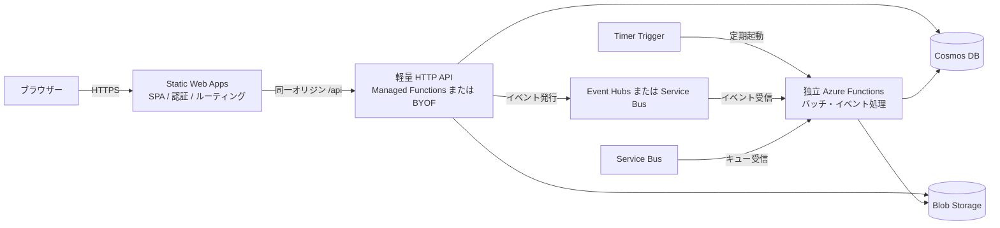

# アーキテクチャとサービスの役割

## 全体像

## コンポーネントの責務

| コンポーネント | 主な役割 | 例 |
|---|---|---|
| Static Web Apps | 静的ファイル配信、SPA の入口、認証、`/api` ルーティング | React/Vue の画面、画面向け BFF |
| Managed Functions | SWA に統合された HTTP API | 小さな CRUD、入力検証、ジョブ受付 |
| BYOF (Bring your own Functions) | 既存 Functions を SWA の `/api` にリンク | Functions の機能を使いつつ API を SWA 経由で公開 |
| 独立 Functions | SWA の API 経路とは別に動くイベント・定期処理 | Timer、Event Hubs、Service Bus、Cosmos DB Change Feed |
| Event Hubs | 大量イベントのストリーミングと並列処理 | テレメトリ、イベント列の取り込み |
| Service Bus | 業務メッセージ、キュー、配信制御 | ジョブキュー、遅延・予約メッセージ |

SWA の API 経路は `/api` 固定で、HTTP のみ、1 リクエスト最大 45 秒です。Managed Functions は HTTP トリガーと限定されたランタイムを使う簡易 API 基盤です。Timer や Event Hubs、Durable Functions、マネージド ID などが必要なら、独立 Functions を使います。

### Managed Functions と BYOF の選択

- **Managed Functions**: アプリと API を一緒にデプロイしやすく、SWA の PR プレビューと組み合わせやすい。利用できるトリガーは HTTP のみ。
- **BYOF**: Standard プランで既存の Functions / API Management / App Service / Container Apps などを接続できます。API のリソースやデプロイは別管理となり、SWA の PR 環境には BYOF API をリンクできません。
- **API を独立 Functions に分けて直接公開**: 画面向けの軽量 API とバッチ用 Functions を分けると、バッチ処理が SWA の 45 秒制限に影響されません。

SWA 経由の API にはネットワーク分離されたバックエンドを接続できません。プライベートネットワーク接続が必須なら、SWA の API 統合が要件を満たすか先に検証してください。

## 非同期・バッチ処理を選ぶ

「定期実行」は Functions Timer Trigger、「イベントのストリームを処理」は Event Hubs Trigger、「業務ジョブをキューイングし、配信や遅延を制御」は Service Bus を候補にします。Event Hubs はスケジューラーではありません。定刻に大量処理する場合は Timer Trigger が対象を読み出して Event Hubs に発行し、後段の Event Hubs Trigger が並列処理する構成が可能です。特定日時にジョブを実行する用途は Service Bus のスケジュールメッセージなどを検討します。

バッチはブラウザーのリクエスト内で完了させず、受付 API がジョブ ID を返し、別 Function が処理、画面が状態を照会する非同期設計にします。再試行・重複配信を想定して、処理を冪等にし、失敗・再処理の記録も設計します。

## 主な公式資料

- [Static Web Apps API の概要](https://learn.microsoft.com/azure/static-web-apps/apis-overview)
- [Static Web Apps の Functions API](https://learn.microsoft.com/azure/static-web-apps/apis)
- [BYOF の設定](https://learn.microsoft.com/azure/static-web-apps/functions-bring-your-own)
- [Functions のトリガーとバインディング](https://learn.microsoft.com/azure/azure-functions/functions-triggers-bindings)
- [Event Hubs Trigger](https://learn.microsoft.com/azure/azure-functions/functions-bindings-event-hubs-trigger)
