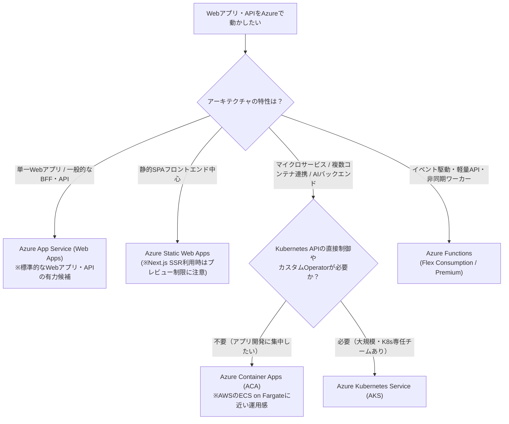
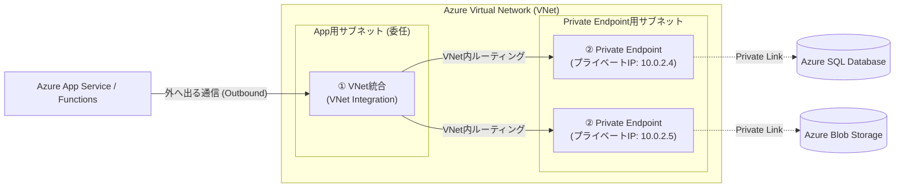

# Webアプリ開発基盤（コンピュート・ネットワーク・配信・API）

Webアプリケーション（SoRの業務画面からSoEのコンシューマー向けサービスまで）をAzure上で設計・構築する際の中核サービス群を、Microsoft Learn の公式情報に基づき AWS と比較しながら解説します。
（参考：[AWS プロフェッショナル向けのコンピューティング サービス - Microsoft Learn](https://learn.microsoft.com/azure/architecture/aws-professional/compute)）

---

## 1. コンピュート・コンテナ・サーバーレスの選定と比較

AWSでは「EC2」「ECS on Fargate」「Lambda」の3択が広く使われていますが、Azureでは **PaaSである「Azure App Service」** と **サーバーレスコンテナである「Azure Container Apps (ACA)」** がWebアプリ開発の主要な選択肢となります。

### 1-1. コンピュートサービス対比表

| カテゴリ | AWS サービス | Azure サービス | 特徴・提供条件とAWS経験者向け解説 |
| :--- | :--- | :--- | :--- |
| **仮想マシン (IaaS)** | Amazon EC2 | **[Azure Virtual Machines (VM)](https://learn.microsoft.com/azure/virtual-machines/overview)** | OSから管理するIaaS。インスタンスファミリーは Dシリーズ（汎用＝AWSのm系）、Bシリーズ（バースト＝t系）、Fシリーズ（計算特化＝c系）、Eシリーズ（メモリ特化＝r系）、Nシリーズ（GPU＝p/g系）。 |
| **VMオートスケール** | EC2 Auto Scaling Group | **[Virtual Machine Scale Sets (VMSS)](https://learn.microsoft.com/azure/virtual-machine-scale-sets/overview)** | 同一構成または柔軟なオーケストレーションモードによるVM群の自動スケーリングと負荷分散連携を提供。 |
| **マネージドWeb PaaS** | Elastic Beanstalk / AWS App Runner | **[Azure App Service (Web Apps)](https://learn.microsoft.com/azure/app-service/overview)** | コード（.NET, Java, Node.js, Python, PHP等）またはDockerコンテナをデプロイして動かすフルマネージドPaaS。組み込み認証（Easy Auth）、デプロイスロット（ステージング環境とのスワップ）、VNet統合、オートスケール機能を備える。 |
| **フロントエンドPaaS** | AWS Amplify Hosting / S3 + CloudFront | **[Azure Static Web Apps (SWA)](https://learn.microsoft.com/azure/static-web-apps/overview)** | SPA（React, Vue, Angular等）向けのホスティングサービス。グローバル配信、GitHub Actions / Azure DevOps自動ビルド、無料SSL、マネージドFunctions統合を提供。 ⚠️ **制限事項**：SSRやApp Router等を使う **[Next.js ハイブリッドレンダリング対応はプレビュー機能](https://learn.microsoft.com/azure/static-web-apps/nextjs)** であり、本記事の「1-3. Static Web Apps における Next.js ハイブリッド対応の注意点」に示す未対応機能がある。 |
| **サーバーレスコンテナ** | Amazon ECS (AWS Fargate) | **[Azure Container Apps (ACA)](https://learn.microsoft.com/azure/container-apps/overview)** | 基盤にKubernetes (AKS + Knative + KEDA + Dapr) を採用しつつ、クラスタ管理を抽象化したサーバーレスコンテナ環境。HTTPトラフィックだけでなく、**KEDAスケーラーによるイベント・キュー長に応じたゼロスケール（0台への縮小）**に対応（従量課金プランおよびワークロードプロファイルプランを選択可）。 |
| **マネージドK8s** | Amazon EKS | **[Azure Kubernetes Service (AKS)](https://learn.microsoft.com/azure/aks/what-is-aks)** | マネージドKubernetes。コントロールプレーン料金が無料の **Freeティア（SLO目標あり・財務保証SLAなし）** と、稼働時間SLAが付帯する **Standardティア / Premiumティア（長期サポートLTS対応）** から選択可能。 |
| **単発コンテナ実行** | AWS Fargate (単発Task) | **[Azure Container Instances (ACI)](https://learn.microsoft.com/azure/container-instances/container-instances-overview)** | オーケストレーション不要で、必要な時に単発のコンテナグループを起動するサービス。なお、定期バッチやイベント駆動の並列ジョブ用途では **[Azure Container Apps Jobs](https://learn.microsoft.com/azure/container-apps/jobs)** も選択できる。 |
| **サーバーレス関数 (FaaS)** | AWS Lambda | **[Azure Functions](https://learn.microsoft.com/azure/azure-functions/functions-overview)** | イベント駆動のFaaS。AWS Lambdaとの主な違いは **「トリガーと入出力バインディング」**（宣言的なデータソース連携）と、ホスティングプランの選択肢（**[Flex Consumption（フレックス従量課金）](https://learn.microsoft.com/azure/azure-functions/flex-consumption-plan)** / Premium / Dedicated Plan / Container Apps ホスティング）。 |
| **ステートフル関数** | AWS Step Functions (+ Lambda) | **[Azure Durable Functions](https://learn.microsoft.com/azure/azure-functions/durable/durable-functions-overview)** | Azure Functionsの拡張機能。JSON等の状態定義言語ではなく、**C# / Python / JavaScript / TypeScript / Java / PowerShell のコード（async/await）でステートフルなオーケストレーション**（関数チェーン、ファンアウト・ファンイン、非同期HTTPポーリング、外部イベント待機等）を記述できる。 |

### 1-2. Webアプリ実行基盤の選び方（意思決定フロー）

（参考：[コンピュート サービスの選択に関する決定ツリー - Microsoft Learn](https://learn.microsoft.com/azure/architecture/guide/technology-choices/compute-decision-tree)）

> [!TIP]
> **App Service Plan（コンピュート枠の共有）の仕組み**
> [Azure App Service Plan](https://learn.microsoft.com/azure/app-service/overview-hosting-plans) では、確保したコンピュートリソース（例：P1v3インスタンス 2台分）の上に、**複数の Web Apps や Functions（Dedicatedプラン時）を同居させて動かす**ことができます。ただし、CPUやメモリは同一プラン内のアプリ間で共有されるため、本番環境で負荷分離が必要な場合はプランを分ける設計が推奨されます。

### 1-3. Static Web Apps における Next.js ハイブリッド対応の注意点（プレビュー）

Azure Static Web Apps では、静的エクスポート（SSG）のSPAだけでなく、サーバーサイドレンダリング（SSR）や App Router、React Server Components を含む **[ハイブリッド Next.js アプリケーションのホスティング（プレビュー）](https://learn.microsoft.com/azure/static-web-apps/nextjs)** が提供されています。
ただし、公式ドキュメントにおいて**プレビュー段階の制限事項（未対応機能）**として以下の点が明記されているため、本番採用時は注意が必要です。

* **リンク済み API（Linked APIs）の非対応**：Standardプラン等で通常利用できる外部バックエンドのリンク機能（Azure Functions、Azure App Service、Azure Container Apps、Azure API Management を `/api` ルートに紐付ける機能）は、ハイブリッド Next.js アプリでは現在サポートされていません（Next.js 自身の API Routes / Route Handlers を使用します）。
* **SWA CLI の非対応**：SWA CLI を用いたローカルエミュレーションおよびデプロイは現在サポートされていません。
* **`staticwebapp.config.json` の一部機能制限**：`navigationFallback` などの一部設定は機能しないため、ルーティングやリライトは `next.config.js` 側で定義する必要があります。
* ※フル機能の Next.js（SSR/ISR）を一般提供（GA）環境かつ閉域網や独自コンテナ構成で運用したい場合は、**Azure App Service** または **Azure Container Apps** 上でホスティングする構成が広く採られます。

---

## 2. ネットワーク・負荷分散・CDN・APIゲートウェイ

（参考：[AWS プロフェッショナル向けのネットワーク サービス - Microsoft Learn](https://learn.microsoft.com/azure/architecture/aws-professional/networking)）

### 2-1. ネットワーク・配信サービス対比表

| カテゴリ | AWS サービス | Azure サービス | 特徴・提供条件とAWS経験者向け解説 |
| :--- | :--- | :--- | :--- |
| **仮想ネットワーク** | Amazon VPC | **[Azure Virtual Network (VNet)](https://learn.microsoft.com/azure/virtual-network/virtual-networks-overview)** | リージョン単位のリソース（1つのVNetが複数AZを跨ぐ点はAWSと同じ）。AzureにはAWSのような「IGWをアタッチしたらPublic Subnetになる」という区別はなく、明示的なアウトバウンド接続には **[Azure NAT Gateway](https://learn.microsoft.com/azure/nat-gateway/nat-overview)** やファイアウォール、ロードバランサー等の利用が推奨される。 |
| **パケットフィルタ** | Security Group (SG) / Network ACL | **[Network Security Group (NSG)](https://learn.microsoft.com/azure/virtual-network/network-security-groups-overview)** / **[Application Security Group (ASG)](https://learn.microsoft.com/azure/virtual-network/application-security-groups)** | NSGは「サブネット」と「NIC」の両方にアタッチできるステートフルなフィルタ。IPアドレスの代わりにVMの論理グループ単位でルールを記述できるのが **ASG**。 |
| **グローバルCDN + L7 LB + WAF** | CloudFront + Route 53 + AWS WAF | **[Azure Front Door (AFD)](https://learn.microsoft.com/azure/frontdoor/front-door-overview)** | グローバルエッジでのCDNキャッシュ、マルチリージョンL7負荷分散（フェイルオーバー）、SSL終端、WAF、DDoS保護を統合したサービス。**Premiumティア**では、バックエンドのApp ServiceやACA、Storage等へ **Private Link経由で閉域接続** できる。 |
| **リージョン内L7 LB + WAF** | Application Load Balancer (ALB) + AWS WAF | **[Azure Application Gateway](https://learn.microsoft.com/azure/application-gateway/overview)** | 単一リージョン（VNet内）のL7ロードバランサー。URLパスベースルーティング、Cookieアフィニティ、WAF機能（WAF_v2 SKU）を提供。またAKSやACA向けのマネージドL7負荷分散として **[Application Gateway for Containers](https://learn.microsoft.com/azure/application-gateway/for-containers/overview)** も提供されている。 |
| **L4 ロードバランサー** | Network Load Balancer (NLB) | **[Azure Load Balancer](https://learn.microsoft.com/azure/load-balancer/load-balancer-overview)** | TCP/UDPレベルのL4ロードバランサー。パブリック用とインターナル（VNet内部）用がある。 |
| **DNS / グローバルルーティング** | Amazon Route 53 | **[Azure DNS](https://learn.microsoft.com/azure/dns/dns-overview)** / **[Azure Traffic Manager](https://learn.microsoft.com/azure/traffic-manager/traffic-manager-overview)** | ドメイン管理・プライベートDNSは **Azure DNS**。DNSベースのグローバル負荷分散は **Traffic Manager**（HTTP/HTTPSのWebアプリでは多くの場合 Azure Front Door が選択される）。 |
| **APIゲートウェイ** | Amazon API Gateway | **[Azure API Management (APIM)](https://learn.microsoft.com/azure/api-management/api-management-key-concepts)** | 認証認可（OAuth2/JWT検証）、レート制限、キャッシュ、開発者ポータルを備えたAPIゲートウェイ。生成AI向けには **[GenAI Gateway 機能](https://learn.microsoft.com/azure/api-management/genai-gateway-capabilities)**（トークン単位のレート制限 `llm-token-limit`、セマンティックキャッシュ、複数バックエンド間の負荷分散・サーキットブレーカー等）を提供する（※Foundry Models側のPTUスピルオーバー機能との違いは [AIエージェント開発ページ](./ai-agent.md) を参照）。 |
| **マネージドFW** | AWS Network Firewall | **[Azure Firewall](https://learn.microsoft.com/azure/firewall/overview)** | ハブ＆スポーク構成のHub VNetに配置するマネージドファイアウォール（Basic / Standard / Premium SKUがあり、TLSインスペクションやIDPSはPremiumで対応）。 |
| **専用線・VPN接続** | AWS Direct Connect / Site-to-Site VPN | **[Azure ExpressRoute](https://learn.microsoft.com/azure/expressroute/expressroute-introduction)** / **[Azure VPN Gateway](https://learn.microsoft.com/azure/vpn-gateway/vpn-gateway-about-vpngateways)** | オンプレミスとの閉域専用線接続は **ExpressRoute**、IPsec VPN接続は **VPN Gateway**。 |
| **大規模WAN統合** | AWS Transit Gateway / Cloud WAN | **[Azure Virtual WAN (vWAN)](https://learn.microsoft.com/azure/virtual-wan/virtual-wan-about)** | 複数のVNet、拠点VPN、ExpressRouteをMicrosoft管理のハブで統合ルーティングするサービス。 |
| **踏み台サーバー接続** | EC2 Instance Connect / SSM Session Manager | **[Azure Bastion](https://learn.microsoft.com/azure/bastion/bastion-overview)** | ブラウザまたはネイティブクライアント（Standard SKU以上）からTLS経由でVNet内のVMへRDP/SSH接続できるマネージド踏み台サービス。 |

---

## 3. Azure PaaSの閉域網構成（VNet Integration vs Private Endpoint）

AWSではLambdaやECSをVPCに紐付ける際「VPC設定（ENIの作成）」という単一の概念で内向き・外向きを扱いますが、AzureのPaaS（App Service, Functions, SQL, Storage等）をVNetと繋ぐ際は、**「通信の向き（Outbound / Inbound）」によって2つの機能を使い分けます**。

1. **① [仮想ネットワーク統合 (VNet Integration)](https://learn.microsoft.com/azure/app-service/overview-vnet-integration) ＝「PaaSからVNetへ出ていく（Outbound）ための経路」**
   * App Service や Azure Functions が、VNet内のVMやPrivate Endpoint、オンプレミス（VPN/ExpressRoute先）へ通信しに行くために使います（専用サブネットの委任が必要）。
2. **② [プライベートエンドポイント (Private Endpoint / Private Link)](https://learn.microsoft.com/azure/private-link/private-endpoint-overview) ＝「PaaSへVNet内から入る（Inbound）ための入口」**
   * AWSの **VPC Endpoint (Interface型 / PrivateLink)** に相当します。
   * Azure SQL Database、Storage、Key Vault、Foundry Models、または前段の App Service 自体に対して、VNet内のプライベートIPアドレスを割り当て、Private DNS Zone と組み合わせて閉域網経由で名前解決・通信を行います。

---

## 4. リアルタイム通信・プッシュ通知（SoEの双方向Web体験）

チャット、AIエージェントのストリーミング応答、リアルタイムダッシュボードなど、WebSocket等を用いた双方向通信をマネージドで提供するサービスです。

| 用途 | AWS サービス | Azure サービス | 特徴と解説 |
| :--- | :--- | :--- | :--- |
| **リアルタイムWeb通信** | API Gateway (WebSocket) / AWS AppSync | **[Azure Web PubSub](https://learn.microsoft.com/azure/azure-web-pubsub/overview)** / **[Azure SignalR Service](https://learn.microsoft.com/azure/azure-signalr/signalr-overview)** | 標準WebSocketやPub/Subサブプロトコルを汎用的に扱うなら **Azure Web PubSub**。.NET（ASP.NET Core SignalR）のハブモデルや自動トランスポートフォールバック（WebSocket / Server-Sent Events / Long Polling）を活用するなら **Azure SignalR Service**。 |
| **モバイルプッシュ通知** | Amazon SNS (Mobile Push) / Pinpoint | **[Azure Notification Hubs](https://learn.microsoft.com/azure/notification-hubs/notification-hubs-push-notification-overview)** | iOS (APNs)、Android (FCM)、Windows (WNS) 等へマルチプラットフォームのプッシュ通知を配信するマネージド基盤。 |
| **メール・SMS・通話** | Amazon SES / Amazon Connect / Chime SDK | **[Azure Communication Services (ACS)](https://learn.microsoft.com/azure/communication-services/overview)** | メール送信（SES相当）、SMS、音声・ビデオ通話・チャット機能（Microsoft Teamsとの相互運用機能を含む）をAPI/SDKでWebアプリに組み込めるサービス。 |
